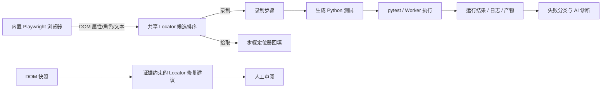

# AI QA Platform 智能开发与测试能力盘点

盘点基于当前工作区代码，状态说明的是代码能力，不代表在当前受限执行环境中完成了真实浏览器验收。录制拾取与候选排序为本轮实现，需以测试和实际运行验收。

| 能力 | 状态 | 现状与依据 |
|---|---|---|
| Automation Studio / Python 编辑 | EXISTS | Monaco 编辑器、工作区文件树、标签页、保存、Git 与运行面板已存在。 |
| Python 语言服务器（补全、语义诊断、Hover、跳转定义） | MISSING | 当前 Monaco 仅配置基础编辑器语言能力，没有 LSP client、Python language server 或服务端桥接。语法着色不能替代 LSP。 |
| QA 助手代码生成/解释/重构/诊断 | PARTIAL | `QAAssistant` 可把当前文件/选区作为上下文发送并展示回复；生成片段可手动插入，但没有统一的差异审阅/应用工作流，不能视为 IDE 补全。 |
| Problems 面板 | PARTIAL | 工作区校验问题可定位到文件和行；尚未统一接入 Python LSP 诊断、Case 失败和 AI 分析问题。 |
| pytest/Playwright 执行与实时状态 | EXISTS | API/Worker 执行链路、SSE 运行状态、历史记录与失败产物能力已实现；完整真实环境验收需可运行的依赖与浏览器。 |
| 失败分类与 AI 诊断 | PARTIAL | 确定性分类和 AI 诊断接口均存在；错误类别依赖规则，诊断结果尚未统一映射为 IDE Problems 条目。 |
| Locator 录制与候选 | PARTIAL → IMPROVED | 录制器已从页面采集角色、测试属性、ID、文本、CSS 与 frame path；本轮新增统一稳定性排序和按步骤拾取元素并回填定位器。 |
| Locator 修复/Healing | PARTIAL → IMPROVED | 既有修复入口保留；本轮去掉无证据猜测，只基于 DOM 中可观察到且与旧选择器相关的属性/文本给建议，无证据时返回零置信度且不建议替换。 |
| 录制脚本生成并转为 Case 运行 | EXISTS | 录制步骤可生成 Playwright Python 脚本、写入工作区、创建 Case 与绑定并发起运行。 |
| Jev Decision Layer | EXISTS | 当前工作区包含 Jev 提供方、设置、凭据存储、决策服务与 API；本轮保留已有未提交实现。 |

## 本轮边界

- 已实现定位器候选排序、录制器拾取并回填步骤、基于 DOM 证据的修复候选筛选。
- LSP 需要编辑器协议客户端、Python server 运行时和跨平台生命周期/通信支持。当前依赖与运行环境均未配置这些组件；本轮不以正则补全或静态提示冒充语言服务器。
- 失败分析统一 Problems、AI 代码修改差异审阅、Case 优化与 Locator healing 的端到端一体化仍为 PARTIAL，需后续逐项交付和 UI 验收。

## 数据流

