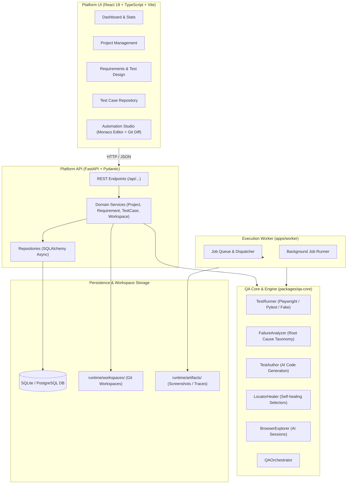

# AI QA Platform — Architecture

## System Overview

The **AI QA Platform** is a browser-based engineering platform designed to support the complete Quality Engineering lifecycle—from requirements analysis, test design, and test case management, to an integrated Automation Studio, execution orchestration, and failure intelligence.

---

## Architectural Boundaries

1. **Frontend (`apps/web`)**:
   - Single Page Application built on React, TypeScript, and Vite.
   - Monaco Editor for in-browser editing of test automation suites, page object models, flows, and knowledge definitions.
   - Desktop-first, engineering-focused UX with zero promotional bloat.

2. **Backend API (`apps/api`)**:
   - FastAPI modular monolith structure adhering strictly to the **Route → Service → Repository / QA Core** dependency layer.
   - Direct database access and shell executions from route handlers are prohibited.
   - SQLite as default local dev/test database with PostgreSQL compatibility through standard SQLAlchemy ORM.

3. **Workspace Subsystem (`runtime/workspaces/`)**:
   - Isolates code checkouts per project.
   - Built-in path traversal safeguards rejecting any `..` or absolute escape vectors.
   - Integrated Git status and unified diff generation for studio source control visibility.

4. **QA Core (`packages/qa-core`)**:
   - Protocol-driven abstractions defining the future migration boundary for execution engines, AI authors, locator healers, and failure analyzers.
   - Deterministic fake implementations enabled out-of-the-box for offline integration testing.

5. **Execution Worker (`apps/worker`)**:
   - Asynchronous background worker foundation for test runs and AI diagnostic tasks.
