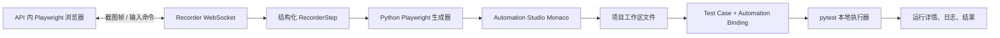

# 浏览器录制器

浏览器录制器把真实的页面操作转换成项目内可发现、可执行的 pytest Case。

## 使用

1. 在侧边栏打开“浏览器录制器”，选择项目并启动浏览器。初始页面为 `about:blank`；在地址栏输入目标 URL 并按 Enter。
2. 开始录制。浏览器运行在 API 服务所在主机/容器中；Docker 部署时目标站点必须能从 API 容器访问。
   如果初始地址访问失败，浏览器会话仍会保留；修改地址并按 Enter 即可重试。
3. 在远程画面中操作。右侧 Steps 面板会持续显示操作，可编辑定位器、操作、参数、说明和顺序，也可以添加断言。
4. 生成 Python 脚本，在 Monaco 中编辑用例名、文件路径、Suite/Module、Case tags 和 pytest markers。
5. 点击“保存为 Case 并运行”。脚本写入项目工作区，平台创建 Case 与自动化绑定，再将绑定的 pytest node id 交给现有本地执行器。完成后打开运行详情查看状态和 pytest 日志。

## 结构



浏览器不嵌入 iframe：API 进程使用 Playwright 控制隔离的 Chromium 上下文，通过 WebSocket 传回压缩截图帧并接收鼠标、键盘、滚动、导航和标签切换命令。HTTP 和 WebSocket 都经过现有身份认证与权限检查。

中间步骤以 Pydantic `RecorderStep` 保存，含动作、定位器、值、描述和 iframe 路径。定位器优先生成 role/accessibility name，其次 test id、稳定 id、name、placeholder、CSS 和文本；重复命中时保存 `nth`。生成代码会把 iframe 路径映射为 Playwright `frame_locator`，并通过 `expect` 执行断言。

当前项目的执行入口是 pytest node id 与工作区文件绑定，因此生成器输出标准 Python Playwright pytest 函数，保存时使用现有工作区、Case、Automation Binding 和 Test Run API。Case tags 中保存 Suite/Module 标签；markers 用于本次 pytest run。生成脚本支持 Playwright 的打包 Chromium，并按环境回退到 Edge/Chrome。

## 浏览器安装

本地 API 使用项目 uv 环境时运行：

```powershell
mise exec -- uv run playwright install chromium
```

API Docker 镜像会在构建时安装 Playwright Chromium 及 headless 运行库。macOS/Windows 上本地录制优先尝试 Chromium，之后回退 Edge/Chrome。

## 目标网站的网络与代理

录制器浏览器、AI 页面探索运行在 API 主机；“保存为 Case 并运行”生成的浏览器测试运行在本地 API 或 worker 主机。两处都需要能访问目标网站。配置 `BROWSER_PROXY_URL` 可让这些 Playwright 浏览器通过 HTTP、HTTPS 或 SOCKS5 代理访问；可选的 `BROWSER_PROXY_BYPASS` 用逗号分隔不走代理的主机。代理 URL 中的用户名和密码会作为 Playwright 认证参数传递。未设置专用变量时，浏览器会尝试使用 `HTTPS_PROXY`、`HTTP_PROXY` 与 `NO_PROXY` 环境变量。

本地开发可在项目 `.env` 中设置：

```dotenv
BROWSER_PROXY_URL=http://proxy.example.com:3128
BROWSER_PROXY_BYPASS=localhost,127.0.0.1
```

Docker Compose 会把这两个变量传给 API 和 worker 容器；修改后重新创建容器。代理地址必须从容器内部可达，不能使用只在宿主机可访问的 `127.0.0.1`。如果没有可用的网络或代理，应用无法绕过主机的出站访问限制；此时使用 API 主机可访问的测试站点地址。

## 数据恢复和限制

- 活跃浏览器 session 保存在 API 进程内存中。前端刷新后可重新连接同一 API 进程里的 session；结构化 Steps 和脚本草稿也保存在浏览器 localStorage。API 进程崩溃后浏览器会退出，但草稿步骤仍可恢复并附加到新 session。保存 Case 时，脱敏后的 `element-evidence-bundle` v1.0 会与 Automation Binding 一起写入数据库；每次保存递增 revision，并归档此前 steps 与决策历史，不能静默覆盖。它只保存交互目标、上下文、Locator 候选、验证与决策历史，不保存填写值或截图；当前 bundle 与归档合计最大 1 MB，超限时保存失败并保留旧数据。失败记录只保存 64 KB 以内的当前页摘要/绑定引用；Locator Repair 从唯一匹配的 ACTIVE binding 读取完整证据并重新验证。
- 生成脚本为每个录制步骤保留 `qa_step_id` 与 `qa_evidence_id=recorder:<step_id>` 源码标记；现有 pytest 浏览器遥测把标记复制到执行步骤和失败快照，使 Run/Execution/Failure/录制证据可按 ID 追溯。标记只是来源元数据，不影响 pytest verdict，也不授权代码修改；手动改写或删除标记会使该关联缺失。
- 同源页面、常见 SPA 导航、输入控件、下拉框、复选框/单选框、悬停、弹窗新标签和手动断言已覆盖。跨域 iframe 的选择器定位按 iframe 属性和层级路径构造；如果页面运行时重建无稳定属性的 iframe，仍需手动修正定位器。
- browser viewport 固定为 1280×720；画面以截图流显示，输入坐标会换算回浏览器视口。视频与 Trace 由现有执行 runner 是否配置相关 fixture 决定，录制器本身不附加它们。
- session 关闭后不会继续运行远程浏览器；录制 Steps 草稿仍保留在浏览器本地，直到用户清理站点存储。跨进程恢复远程浏览器本身尚不支持；持久化的是保存 Case 时的元素证据，而非可恢复的浏览器上下文。
