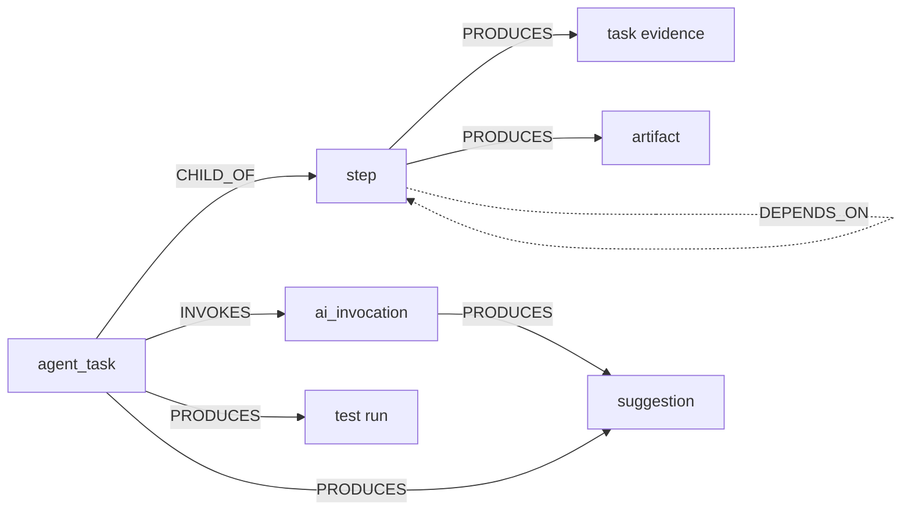

# Agent Execution Trace — audit, contract and boundaries

Round 16.5. Everything below was read from the code and from the rows in `runtime/ai_qa_platform.db`;
nothing is inferred from documentation alone. Where a relationship does not exist, the trace says
`UNKNOWN` instead of inventing one.

## 1. Stores that hold execution facts

| Store | Table | Real columns that carry execution facts | Written by |
| --- | --- | --- | --- |
| Task | `agent_tasks` | `id, type, status, inputs, context, verification, current_step_id, failure_reason, created_at, started_at, finished_at, retry_count, replan_count` | `TaskCommandService`, `TaskSchedulerService` |
| Step | `agent_task_steps` | `id, task_id, position, key, name, tool, status, dependencies, inputs, outputs, decision, retry_count, error, started_at, finished_at, duration_ms` | `TaskRuntimeService`, `TaskExecutionOrchestrator` |
| AI call | `ai_invocations` | `id, request_id, task_id, run_id, task, provider, model, status, duration_ms, input_tokens, output_tokens, token_source, retry_count, fallback_used, error_type, decision_name/choice/confidence/value` | `AIRepository.record_invocation` at every provider call |
| Task evidence | `agent_task_evidence` | `id, task_id, step_id, type, source, summary, content, artifact_id, metadata_json, created_at` | `TaskEvidenceService` |
| Task artifact | `agent_task_artifacts` | `id, task_id, step_id, artifact_id, name, kind, created_at` | `TaskEvidenceService` |
| Task decision | `agent_task_decisions` | `id, task_id, step_id, name, provider, choice, confidence, rationale, created_at` | `TaskAIService._analyze_requirement` |
| Live events | `agent_task_events` | `id (autoincrement cursor), task_id, step_id, type, payload, created_at` | `TaskRepository.add_event` |
| Run | `test_runs` | `id, task_id, parent_run_id, origin_failure_id, status, nodeids, total/passed/failed/skipped, duration_ms` | `TestRunService` |
| Discovery evidence | `discovery_evidence` | `id, run_id, kind, evidence_id, state_id, step_id, artifact_id, payload, observed_at` | `QualityDiscoveryExecutionService` capture hooks |
| Discovery suggestion | `discovery_suggestions` | `id, run_id, suggestion_id, scenario_id, analysis_status, review_status, task_id, invocation_id, evidence_ids, payload, jev, review` | `TaskDiscoveryIntelligenceService` |

## 2. Relationships that really exist

```
agent_tasks.id ──1:N── agent_task_steps.task_id
agent_tasks.id ──1:N── agent_task_evidence.task_id           (and step_id when the writer knows it)
agent_tasks.id ──1:N── agent_task_artifacts.task_id          (and step_id)
agent_tasks.id ──1:N── agent_task_decisions.task_id          (and step_id)
agent_tasks.id ──1:N── ai_invocations.task_id                (real for every task-driven AI call)
agent_tasks.id ──1:N── agent_task_events.task_id             (step_id on step-scoped events)
agent_tasks.id ──1:N── test_runs.task_id                     (the run a task asked for)
test_runs.id   ──1:N── failure_records.run_id                (a run that failed)
quality_discovery_runs.id ──1:N── discovery_evidence.run_id
quality_discovery_runs.id ──1:N── discovery_suggestions.run_id
discovery_suggestions.invocation_id ──1:1── ai_invocations.id
```



## 3. What the stored rows prove (real sample)

Task `e4586e10e1ba485d94d97bff1d3e60f6` (`ANALYZE_DISCOVERY`, COMPLETED, 03:34:21 → 03:34:58):

| Step | Tool | Status | Duration |
| --- | --- | --- | --- |
| `collect` | `discovery.collect_gaps` | COMPLETED | 24 ms |
| `analyze` | `discovery.analyze_gaps` | COMPLETED | 34 512 ms |
| `grade` | `discovery.grade_gaps` | COMPLETED | 491 ms |
| `finalize` | `discovery.summarize_gaps` | COMPLETED | 18 ms |

Invocations attached to that task (`ai_invocations.task_id = e4586e10…`):

| Invocation | AI task | Provider | Model | Status | Duration | Tokens (`token_source`) |
| --- | --- | --- | --- | --- | --- | --- |
| `637c52f6…` | `discovery_suggestion` | `openai-compatible` | `mimo-v2.6-flash` | SUCCESS | 34 448 ms | 1587 / 668 (`provider`) |
| `024100d9…` | `discovery_evidence_sugg_be5d…` | `jev` | `jev-1.13.0` | SUCCESS | 457 ms | 552 / 38 (`provider`) |

Events for the same task are a gapless cursor 839 → 851 (`task.created`, `step.started`,
`step.progress {type: ai.call, ai_run_id}`, `step.completed`, `task.completed`).

## 4. Gaps — recorded as `UNKNOWN`, never filled in

| Gap | Evidence | Consequence in the trace |
| --- | --- | --- |
| No parent/child tasks | `agent_tasks` has no `parent_task_id` column; no code path creates a task from a task (runs are created instead) | `parent_id = null`, no task→task `CHILD_OF` edge; `unknown: ["parent_task_id"]` |
| Invocation has no step reference | `ai_invocations` has `task_id`, `run_id`, `request_id` — no step column | before migration 0018: `INVOKES` edge goes to the task; step attribution is `UNKNOWN` |
| Suggestion `task_id` never written | 9/9 rows have `task_id IS NULL`, `invocation_id` is set | fixed in this round by writing the column (no migration) |
| No cost data | no price table anywhere in the code base | `cost = null`, `pricing = "unpriced"` |
| Tokens not always reported | `token_source = "unknown"` when the provider reported none or the provider is `fake` | `token_usage = null`, `unknown: ["token_usage"]` |
| Evidence is run-scoped, not task-scoped | `discovery_evidence` has `run_id`; the task only reaches it through the run | evidence nodes hang off the suggestion/step that cited them |
| Browser/tool operations are not separate rows | they appear only as steps (`tool` column) and events | a step node carries the tool name; no invented sub-nodes |

## 5. Contract

`packages/project-model/project_model/execution_trace.py`

```
ExecutionTrace   { root_task_id, project_id, status, generated_at, nodes, edges, counts, unknown }
ExecutionNode    { id, type, label, task_id, invocation_id, parent_id, started_at, finished_at,
                   status, position, tool, provider, model, token_usage, evidence_ids, inputs,
                   outputs, error_code, error_message, cost, pricing, unknown, fallback_used, links }
ExecutionEdge    { id, source, target, type }
```

- `type` ∈ `task | step | invocation | evidence | artifact | run | suggestion`
- `type` of an edge ∈ `CHILD_OF | INVOKES | PRODUCES | DEPENDS_ON`
- `status` keeps the server's own string (`PENDING/RUNNING/COMPLETED/BLOCKED/CANCELLED/FAILED/WAITING_FOR_APPROVAL/…`); the UI translates, the server never maps two states into one.
- `inputs`/`outputs` are **safe summaries**: scalars and short strings only (≤160 chars), keys matching the redactor's sensitive list dropped, nested structures replaced by a shape description (`{items: 3}`). The raw prompt and the raw model response are never sent.
- `unknown` lists the fact names the server could not establish for that node — the UI shows 「未知」 for exactly these.
- `cost` is `null` with `pricing: "unpriced"` unless a real price table exists; tokens are reported only when `token_source = "provider"`.
- `links` holds routes back to the screens that already own the row (`/runs/{id}`, `/runs/tasks?taskId=`, the run's canvas view); the tree never becomes a second navigation system.
- Node ids are `type:row-identity`. A suggestion is identified by its **row id**, not by `suggestion_id`, because the same scenario is re-proposed by every run and the project view merges several tasks.

## 6. API

| Endpoint | Purpose |
| --- | --- |
| `GET /api/tasks/{task_id}/execution-trace` | one task as the root, its steps, invocations, evidence/artifacts and produced runs/suggestions |
| `GET /api/projects/{project_id}/execution-trace?limit=6` | the same projection for the most recent tasks, several roots side by side |

Both are read-only, require a bearer token and reuse the existing task/project access checks. Nothing
in this layer writes: no task is created, no provider is called, no state is replayed into the runtime.

## 7. One minimal migration

`0018_ai_invocation_step` adds `ai_invocations.step_id` (nullable, indexed, `ON DELETE SET NULL`).
The writer is the AI repository, which reads a per-step context variable set by the orchestrator, so
no call site changes. Historical rows keep `step_id = NULL` — that is the honest `UNKNOWN`, not a
guess reconstructed from timings. `downgrade` drops the column.

## 8. Live view

The tree is server-authoritative: the client subscribes to `GET /api/tasks/{task_id}/events?after=<cursor>`
(the existing SSE stream, which honours `Last-Event-ID`), and on every event refetches the projection.
New invocations therefore appear because the server stored them, never because the client synthesised
them. A dropped stream reconnects with its last seen event id, and the refetch is idempotent — nodes are
keyed by server ids, so a replay cannot duplicate them.

## 9. Not in this round

- No editing: the tree cannot start, retry, cancel or reorder anything.
- No synthetic "agent" nodes for tools; a tool is a step, with its real `tool` name.
- No parent/child tasks until a real producer exists.
- No cost figure until a real price table exists.
- Round 17 (editable workflow) boundary: an editable graph would need a versioned workflow definition
  per project, a diff between the definition and the recorded execution, and an approval gate before a
  definition change takes effect. None of that exists today, and the read-only projection above is the
  data source it would have to diff against.
