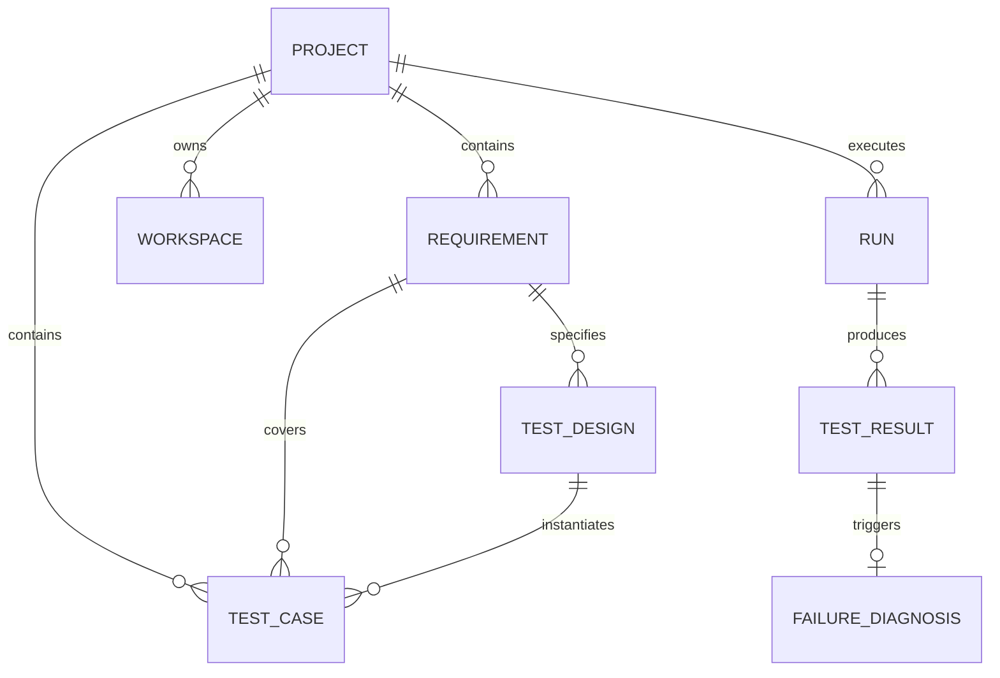

# Product Domain Model

This document outlines the core business entities and their relationships within the AI QA Platform.

---

## Entity Definitions

### 1. Project
The top-level boundary for QA engineering activities. Represents a target application suite (e.g. Web Frontend, Mobile Backend, API Services).
- **Attributes**: `id`, `name`, `description`, `repository_url`, `default_branch`, `framework_type`, `created_at`, `updated_at`.

### 2. Requirement
User stories, feature requirements, or specifications mapped to the platform.
- **Attributes**: `id`, `project_id`, `title`, `description`, `acceptance_criteria`, `status` (`DRAFT`, `READY`, `ARCHIVED`).

### 3. TestDesign
Systematic decomposition of a Requirement into coverage dimensions.
- **Attributes**: `id`, `requirement_id`, `title`, `category` (`FUNCTIONAL`, `BOUNDARY`, `NEGATIVE`, `ANALYTICS`, `API`, `UI`), `description`, `risk`, `status`.

### 4. TestCase
Platform business test cases containing business steps, preconditions, expected outcomes, and priority.
- **Key Concept**: `Test Case != Python test function`. The Test Case represents business intent, while code in the Workspace represents automation implementation.
- **Attributes**: `id`, `project_id`, `requirement_id`, `test_design_id`, `title`, `preconditions`, `steps`, `expected_result`, `priority` (`P0`, `P1`, `P2`, `P3`), `automation_status` (`MANUAL`, `DRAFT`, `AUTOMATED`), `tags`.

### 5. Workspace
The isolated file-system working directory backing a project's automation code.
- **Attributes**: `id`, `project_id`, `path`, `branch`, `status` (`ACTIVE`, `INITIALIZING`, `ARCHIVED`).

### 6. Run & Failure Intelligence
Aggregated test suite execution sessions and AI-assisted root cause classification.
- **Run Status**: `QUEUED`, `RUNNING`, `PASSED`, `FAILED`, `ERROR`, `CANCELLED`.
- **Failure Taxonomy**: `LOCATOR_CHANGED`, `TIMING_ISSUE`, `ASSERTION_FAILURE`, `ENVIRONMENT`.
