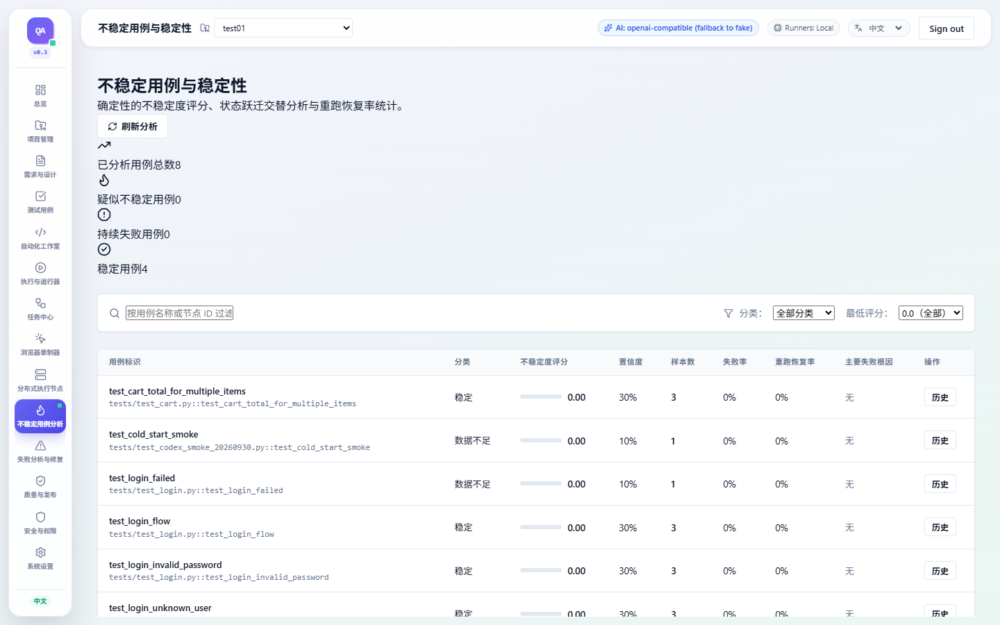
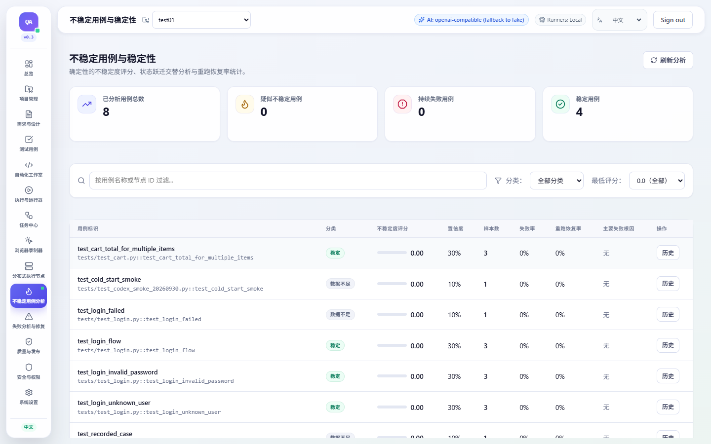

# 全站 UI 修复审计

日期：2026-09-30
范围：AI QA Platform Web 前端全部 14 个主路由、共享导航/页头/表格/状态组件，以及 Recorder、Workers、Runs、Tasks、Test Cases 等重点页面。

## 结论

全局样式根因是样式表只保留了 App Shell 和一部分设计 token，却没有提供多个页面已依赖的共享页面与组件选择器；同时，一些旧页面引用的颜色 token 未定义。结果是页面结构仍在，但标题、统计卡片、状态、表格、Tab 和表单控件各自退化为浏览器默认外观或局部 inline 样式。

Recorder 页面还把工作区、步骤编辑和控制项大量写成裸元素与行内布局；Test Cases 的长文件路径/pytest 节点 ID 会扩大网格的最小内容宽度；Runs 的执行详情操作区在窄屏也曾超出内容区。样式层已补齐，并针对这些页面逐项修复。

## 已修复发现

| 严重度 | 发现 | 影响 | 修复 |
| --- | --- | --- | --- |
| P1 | 页面容器、标题、统计卡片、状态标记、Tabs、表格滚动容器等共享选择器缺失；旧页面引用的兼容色彩 token 未定义 | Projects、Requirements、Test Cases、Runs、Workers、Flaky、Failures、Quality、Security、Settings、Tasks 等 | 补齐共享组件样式、语义状态色与兼容变量；为裸表单控件提供低优先级基础样式 |
| P1 | Recorder 依赖原生控件和散落行内布局，缺少一致的浏览器工作区/步骤编辑结构 | Recorder | 建立统一工作区、浏览器面板、Inspector、步骤编辑器与响应式布局；保留已有录制、AI 任务和 API 行为 |
| P1 | Test Cases 双栏网格受长内容的 min-content 宽度影响，桌面可能横向溢出 | Test Cases | 网格列改用 `minmax(0, …)`，详情内容允许长标识换行，绑定元数据在窄屏改单列 |
| P2 | Workers 概览缺少在线 Worker 数，浏览器支持信息与健康状态不够清晰 | Workers | 展示 5 项概览指标，增加 Playwright/浏览器标记、操作系统、负载条和心跳状态 |
| P2 | 完成态 Runs 日志始终占用大块深色区域；空 Tasks 详情面板高度过大 | Runs、Tasks | 完成态控制台默认折叠，执行中自动展开；空详情面板收紧并保留清晰空态 |
| P2 | Settings 内容列最大宽度 720px，宽屏右侧留下过多空白 | Settings | 将内容列扩至最大 1280px，并保留窄屏内边距 |
| P2 | 390px 下 Runs 详情 Header 与 Test Cases 绑定元数据挤压内容区 | Runs、Test Cases | Header 操作项允许换行；绑定信息改为单列，长路径与节点 ID 可折行；表格限制在局部横向滚动容器 |
| P2 | 520px 以下导航标签缩至 8px，且次级正文颜色对比度低于 4.5:1 | 全站窄屏导航与辅助文字 | 窄屏改用 44px 图标入口并保留可访问名称；`--ui-ink-muted` 调为 `#626b80`，与白色/画布对比度分别为 5.34:1、4.98:1 |
| P2 | Recorder 远程浏览器键盘转发会拦截 Tab 焦点 | Recorder | 增加可见的 `Shift + Esc` 退出提示；组合键将焦点交还浏览器地址输入框，普通 Escape 仍转发给远端页面 |
| P3 | Dashboard 最近任务中的长目标文本会推挤卡片布局 | Dashboard | 将任务标题和状态约束在卡片宽度内并允许换行 |

以上发现均已修复；当前 UI 复核未发现开放的 P0 或 P1 项。

## 路由覆盖

| 页面 | 路由 | 重点复核项 |
| --- | --- | --- |
| Dashboard | `/` | 指标卡片、最近任务长文本 |
| Projects | `/projects` | 统计、列表、页面留白 |
| Requirements | `/requirements` | 页面头部、异步状态、双栏内容 |
| Test Cases | `/test-cases` | 主从布局、绑定信息、长标识与表格 |
| Automation Studio | `/projects/{projectId}/studio` | 全屏工作台、文件/编辑/Assistant 面板 |
| Runs | `/runs` | 执行列表、详情、折叠日志、窄屏 Header |
| Tasks | `/tasks` | 筛选、列表/详情分栏、空详情状态 |
| Recorder | `/recorder` | 浏览器工作区、Inspector、步骤与脚本编辑 |
| Distributed Workers | `/workers` | 5 项统计、浏览器标签、负载与心跳表格 |
| Flaky Tests | `/flaky` | 统计卡片、筛选、宽表滚动 |
| Failures | `/failures` | 诊断面板、严重级别、错误详情 |
| Quality | `/quality` | 统计、表格和筛选控件 |
| Security | `/security` | 状态、审计表格、管理操作 |
| Settings | `/settings` | AI 配置、偏好设置、宽屏内容列 |

## 验证结果

- 前端 ESLint：通过。
- 前端 TypeScript 与 Vite Production Build：通过。
- Playwright：14 个路由分别在 1440×900、1920×1080 检查，共 28 次；再对 Recorder、Test Cases、Workers、Runs、Settings 在 390×844 检查，共 5 次。33 次均 HTTP 200，无页面级异常、文档横向溢出或内容区横向溢出。检查记录也包含每页 muted token 对比度、导航 accessible name 与截图文件名。
- Runs 完成态控制台在路由检查中默认为关闭；控制台可通过原生 `
`/`
` 键盘和点击切换。
- Recorder 远程视图聚焦后按 `Shift + Esc` 可将焦点移至地址输入框；窄屏导航项均保留可访问名称。
- 输出明细：[`audit-results.json`](../output/playwright/audit-results.json)。截图位于 [`output/playwright`](../output/playwright)。

## 截图对比

开始修复前没有保存当前工作区的完整截图。以下“旧样式参考”是在相同数据与未改动的 Flaky 页面上重新应用 Git HEAD 的 `index.css` 生成，用来隔离展示共享样式层的差异；它不是任务开始时截取的原工作区快照。

| 旧全局样式参考 | 修复后 |
| --- | --- |
|  |  |

重点页面截图：

- [Recorder 1440×900](../output/playwright/recorder-1440x900.png)
- [Workers 1440×900](../output/playwright/distributed-workers-1440x900.png)
- [Runs 1920×1080](../output/playwright/runs-1920x1080.png)
- [Test Cases 390×844](../output/playwright/test-cases-390x844.png)
- [Runs 390×844](../output/playwright/runs-390x844.png)

## 剩余 P2/P3

| 严重度 | 项目 | 影响与建议 |
| --- | --- | --- |
| P2 | `MonacoEditorPane` 构建产物约 4,020 kB（gzip 约 1,040 kB），Vite 提示 chunk 超过 500 kB | 自动化工作台的首次资源加载可能偏慢。建议单独评估 Monaco worker/语言包拆分；本次未改动编辑器依赖与打包架构 |
| P3 | 多处旧页面仍有局部 inline 间距/颜色声明 | 当前共享控件外观由 token 和基础层统一；未来可在页面维护时逐步迁移成语义 class，减少长期样式漂移 |

## 独立 Reviewer

最终复核结论：未发现 P0、P1 或 P2 的 UI 问题。Reviewer 确认窄屏导航可读、`--ui-ink-muted` 对比度达到 AA、Recorder 可通过 `Shift + Esc` 退出远程键盘控制，Runs 折叠箭头清晰且可用键盘切换。复核检查了全部 33 张最新视口及交互记录，HTTP 失败、页面异常、横向溢出均为 0。构建中的 Monaco 大 chunk 提示和旧页面 inline 样式属于另列的性能/维护项，不影响该 UI 结论。
