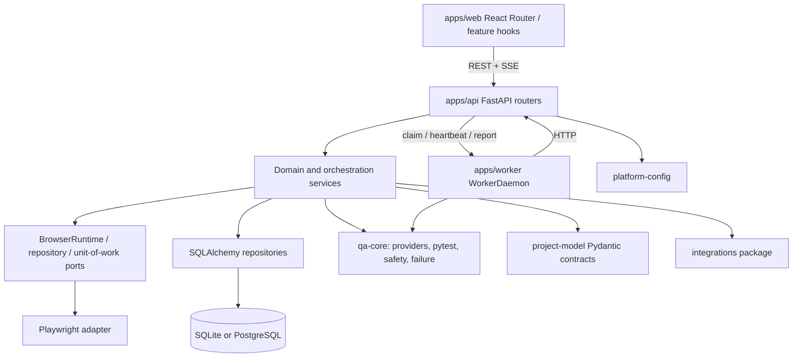

# Current-State Architecture Review

**Review date:** 2026-10-28 (local timezone CST)<br>
**Repository snapshot:** `main`, HEAD `245c00cacd946c8dea59991807af6b873fcdaf1d`. The worktree was already heavily modified/untracked at intake (including application, test, design, `.pi`, and handoff files). This review does not attribute those changes to itself; source observations describe the working-tree contents and are not a clean-HEAD diff audit. No production source was edited.

## Status vocabulary

- **VERIFIED** — confirmed by current source, manifest, or test definition. It does not imply that a runtime test was executed.
- **PARTIAL** — a real implementation exists, but its lifecycle, backend parity, production behavior, or acceptance is not established end to end.
- **MISSING** — no implementation was found in the inspected source for the stated capability.
- **UNKNOWN** — cannot be established from this source-only review or available evidence.

A test file is evidence that a check is defined, not evidence that it currently passes. Runtime evidence is separately recorded in `poc-results.md` and `verification-report.md`.

## Executive assessment

The current platform is a **reasonable modular monolith plus a separate execution worker**, not a blank-sheet architecture. It already has useful seams for services/repositories, a single task orchestration entry point (`TaskRuntimeService`), a browser port (`BrowserRuntime`), capability-specific AI decision/provider services, deterministic Pytest execution, persisted evidence, authorization, and a React workflow projection. Replacing the stack or importing a large agent platform is not justified by the evidence.

The main architectural weakness is **lifecycle fragmentation**, not the choice of FastAPI, React, SQLAlchemy, or Playwright. A task, test run/job, and Quality Discovery run have related but distinct state/event/evidence models. Task execution is persisted and cursor-replayable; Discovery persists a bounded result/event array but also uses process-local task/session/event state; browser/debug/recorder sessions are process-owned. Runtime behavior and evidence therefore do not share one durable contract or recovery rule. The API also owns an in-process task scheduler while WorkerDaemon owns distributed Pytest execution.

A second, narrow source concern is `packages/qa-core/qa_core/explorer/engine.py`: the exported `BrowserExplorer` is a hard-coded illustrative stub and has no repository callers. The production browser exploration path is instead in `apps/api/app/services/task_browser_executor.py` and `apps/api/app/services/quality_discovery_execution.py`. Do not delete the stub until external consumers and package compatibility are checked.

**Preliminary answer:** keep the current stack and business behavior; evolve toward candidate B through additive contract/recovery changes. The architecture decision gate remains **DEFERRED**, because official framework/license research could not be fetched and the comparative framework/browser PoCs could not run.

## 1. Monorepo and dependency map — VERIFIED

### Boundaries

- `apps/web/`: React 19/Vite single-page desktop application. Routes live in `apps/web/src/app/routes.tsx`; shared project/preferences state is in `ProjectScope.tsx` and `Preferences.tsx`; API client and generated OpenAPI types are in `apps/web/src/api/`.
- `apps/api/`: FastAPI, domain/use-case services, SQLAlchemy models/repositories, adapters, ports, migrations, and API tests.
- `apps/worker/`: HTTP-connected worker daemon that claims execution jobs and invokes the shared `qa_core.execution.PytestRunner`.
- `packages/project-model/`: shared Pydantic schemas and task/status/evidence contracts (`project_model/task_models.py`, `models.py`, `lifecycle.py`).
- `packages/qa-core/`: Pytest runner, AI/provider contracts, browser safety, failure classification, locator ranking, and shared execution utilities.
- `packages/platform-config/`: typed shared settings/config loader.
- `packages/integrations/`: Jira/TestRail/GitHub/Jenkins connector interfaces and adapters.
- `runtime/`: user workspace/runtime material; root instructions explicitly exclude runtime artifacts from source changes/commits.

Python workspace composition is in `pyproject.toml`; web workspace and package manager are in root `package.json`, `pnpm-workspace.yaml`, and `apps/web/package.json`. The worker communicates with the API rather than connecting directly to its SQLAlchemy database (`apps/worker/worker/daemon.py`, `apps/api/app/api/jobs.py`).



### Installed/runtime versions observed locally

`uv run --no-sync` metadata: Python 3.13.15, FastAPI 0.141.1, SQLAlchemy 2.0.54, asyncpg 0.31.0, aiosqlite 0.22.1, Pydantic 2.13.5, pytest 9.1.1, Playwright **1.62.0**, Uvicorn 0.53.0, debugpy 1.8.22, HTTPX 0.28.1. `pnpm list` resolved React/ReactDOM 19.3.0, React Router 7.18.4, Vite 6.4.3, TypeScript 5.7.3, and Monaco 0.56.0. These are local resolved versions, not an independent cross-platform compatibility claim. Playwright is pinned exactly to 1.62.0 in `apps/api/pyproject.toml` and `apps/worker/pyproject.toml`.

## 2. FastAPI API / service / repository / ORM — VERIFIED, with bounded exceptions

### Observed structure

At the review snapshot, `apps/api/app/api/` has 39 router modules, `services/` 86 top-level modules, `repositories/` 35, and `persistence/` 3. Counts are approximate file counts, not architecture quality metrics.

- `apps/api/app/main.py` constructs FastAPI, installs auth, CORS, error, stream-ticket and request-metrics middleware, mounts the routers, and owns application lifespan/recovery.
- `apps/api/app/container.py` is the composition root for repositories, service factories, `TaskRuntimeService`, `QualityDiscoveryService`, `BrowserRuntime`, Recorder, and health services.
- Routers in `apps/api/app/api/` mostly validate HTTP input/auth and invoke service objects.
- Services own workflows/business rules; repositories own SQLAlchemy persistence; ORM records are in `apps/api/app/persistence/models.py`; schema evolution uses `apps/api/alembic/versions/` (revisions `0001` through `0015`).
- `apps/api/app/ports/` defines browser, database-health, repository-scope, transaction, and task-UoW boundaries. `apps/api/app/repositories/task_unit_of_work.py` coordinates task-side repository work.
- `apps/api/tests/test_architecture_boundaries.py` enforces selected router/service/repository and Playwright ownership rules. `RuntimeProjection` in `apps/api/app/services/runtime_projection.py` is an intentional direct-query/read projection exception.

### Main calls

```text
ASGI lifespan (apps/api/app/main.py)
  -> init_db / Alembic
  -> recover AI invocations, failure analyses, requirement lifecycle, stale TestRuns
  -> TaskRuntimeService.start()
       -> TaskSchedulerService (persisted agent_tasks)
       -> TaskExecutionOrchestrator (registered fixed tool dispatch)
       -> domain services and TaskUnitOfWork/repositories
  -> recover interrupted QualityDiscovery rows as PAUSED

HTTP route (apps/api/app/api/<domain>.py)
  -> container dependency (apps/api/app/container.py)
  -> domain service
  -> repository / shared unit of work
  -> SQLAlchemy ORM
```

### Assessment

**VERIFIED:** the main layering is explicit and guarded by tests.<br>
**PARTIAL:** the service surface is large and there are substantial workflow services/mixins; source-level boundaries do not prove all behavior is isolated or small. `TaskExecutionOrchestrator` is a large fixed dispatch composition; `QualityDiscoveryService` composes execution/graph/projection/draft mixins. No replacement is recommended on this evidence.

## 3. React routes, state, and component structure — VERIFIED

- `apps/web/src/app/routes.tsx` uses React Router `<Routes>` and feature/page route components; route-specific context is translated from query/path by `apps/web/src/app/workspaceContext.ts`.
- `ProjectScope.tsx` and `Preferences.tsx` are React Context providers. Workspace stages are URL-backed; most page/data state is feature hooks and local React state. No Redux/Zustand/query-cache package is in the web manifest.
- `apps/web/src/api/client.ts` is the API client; `apps/web/src/api/openapi.json` and generated schema types are the REST contract. CI checks generated OpenAPI types for drift.
- Feature ownership is organized under `apps/web/src/features/` (workspace, automation studio, runtime, workflow, recorder, requirements, failures, quality, etc.) and legacy/overview pages under `apps/web/src/pages/`.
- `apps/web/src/features/workspace/WorkspacePage.tsx` is the central workspace composition and owns query-backed task/run/failure/file context. Desktop visual direction is governed by `docs/UI_DESIGN_SYSTEM.md` and project `AGENTS.md` (Graphite/Desktop First).

**PARTIAL:** page behaviors and desktop layout are not established by route source alone. No full frontend tests or screenshots were run for this review; prior handoff/browser material is historical context, not new validation.

## 4. Worker, scheduler, execution lifecycle — PARTIAL

Two related execution systems exist:

1. **Task workflow orchestration:** `apps/api/app/services/task_runtime_service.py` composes `TaskCommandService`, `TaskSchedulerService`, and `TaskExecutionOrchestrator`. `TaskORM`, `TaskStepORM`, `TaskEvidenceORM`, `TaskDecisionORM`, and `TaskEventORM` are durable records (`apps/api/app/persistence/models.py`). Task plans use registered tool names and dependencies from `apps/api/app/services/task_workflows.py`; they are not user-supplied executable DAG definitions. Scheduler claims are database-conditional and bounded; API startup marks interrupted in-flight task steps failed and their task `BLOCKED` rather than blindly replaying side effects (`task_scheduler_service.py`).
2. **Pytest run execution:** `apps/api/app/services/test_run_service.py` creates `TestRun`/`TestExecution`, supports local execution and worker jobs, and interprets the Pytest runner result. `apps/worker/worker/daemon.py` registers, heartbeats, claims jobs, and reports completion. `packages/qa-core/qa_core/execution/pytest_runner.py` launches Pytest subprocesses with timeout/cancellation handling.

The Task Runtime usually owns the bounded workflow, while a test execution may create a child TestRun/Worker job. `QualityDiscoveryService._start()` delegates to `TaskCommandService` when wired by `container.py`, but also retains an in-process `_schedule()` fallback for standalone constructions/tests. The runtime task and Quality Discovery row remain separate persistence/state models.

**Risks:**

- API-local task scheduling, distributed test execution, and the Discovery run lifecycle have distinct claims, statuses, and recovery rules.
- Interrupted Task steps are blocked for human review; this is safe against duplicate effects but is not transparent automatic resume.
- Task scheduler concurrency is process-local; task persistence does not by itself establish multi-API-instance fairness/lease behavior.
- `TestRunService` can execute locally inside the API as well as through WorkerDaemon, so process isolation depends on deployment/configuration.

## 5. Playwright, Pytest, Recorder, and Debugger — VERIFIED, process recovery PARTIAL

- `apps/api/app/ports/browser_runtime.py` is the application-facing browser protocol. `apps/api/app/adapters/playwright/browser_runtime.py` owns Playwright startup, browser contexts, page snapshots/actions, evidence, and resource cleanup; the architecture tests enforce that application services do not own Playwright imports.
- Browser-oriented workflow code is in `apps/api/app/services/task_browser_executor.py`; it uses `TaskAIService`, `TaskDecisionService`, action policy, observed page candidates, bounded retries/recovery, effect verification, and browser snapshots via the shared runtime.
- Quality Discovery uses the same BrowserRuntime and emits evidence/DOM inventory; its separate live viewer fan-out is `apps/api/app/services/quality_discovery_live.py` and `apps/web/src/features/workspace/DiscoveryLiveView.tsx`.
- Recorder logic is `apps/api/app/services/recorder_service.py` / `recorder_workflow_service.py` and API routes `apps/api/app/api/recorder.py`. Recorded sessions are browser-runtime resources; draft/client context is persisted separately.
- Debugging is a separate `debugpy` DAP process per debug session in `apps/api/app/services/debug_session_service.py`; session persistence/projection and HTTP control are in `debug_session_repo.py` and `apps/api/app/api/debugger.py`.
- Deterministic test execution is in `packages/qa-core/qa_core/execution/pytest_runner.py`, with local and distributed callers in `TestRunService` and WorkerDaemon.

**PARTIAL:** browser/debug/recorder process resources are owned and closed by API lifespan, but this source review does not establish live browser session takeover after an API restart. Worker/test processes are bounded by configured timeouts, but an OS-level sandbox was not found in the inspected runner call path: user project Pytest code is executed as a subprocess under worker/API identity. A stronger per-job container/OS policy should be evaluated before accepting untrusted projects in a shared host.

## 6. Discovery Intelligence and Locator Repair — VERIFIED, persistence/recovery PARTIAL

### Discovery

`apps/api/app/api/quality_discovery.py` -> `QualityDiscoveryService` (`quality_discovery_service.py`) -> persisted `QualityDiscoveryRunORM` (`models.py`, `quality_discovery_repo.py`) -> `QualityDiscoveryExecutionMixin` (`quality_discovery_execution.py`) -> `BrowserRuntime`, `DecisionService`, and configured `AIProviderRegistry`. Exploration records states, actions, findings, evidence, coverage and a bounded events list in `quality_discovery_runs.result` JSON. `QualityDiscoveryLiveHub` streams live events/frames to subscribers but does not persist frames and is explicitly an in-process fan-out. Startup recovery changes non-terminal Discovery rows to `PAUSED`; `resume()` schedules via Task Runtime when task commands are wired.

### Locator repair

`apps/api/app/services/locator_decision_service.py` ranks a bounded set of observed candidates, applies decision policy and verifies through the Playwright locator adapter. `FailureWorkflowService` and `LocatorRepairStateMachine` persist analysis/proposal/apply/rollback/verification transitions; the API exposes preview/apply/rollback/verify operations. The human approval boundary and audit behavior are represented in tests and service state.

**PARTIAL:** Discovery state is durable but its live sequence, subscriber queues, and browser-session references are process-local. Its event array is bounded and is not the same cursor-addressable event table used by Task Runtime. A current provider-backed Discovery/repair success was not tested here. `packages/qa-core/qa_core/explorer/engine.py` exports a fixed, synthetic `BrowserExplorer` and is unreferenced elsewhere in this repo; do not confuse it with the service-backed product implementation.

## 7. Workflow Canvas, DAG, and Execution Trace — VERIFIED as observer, not authoring engine

- Workflow route is `apps/web/src/features/workflow/WorkflowPage.tsx`.
- A selected task/run renders `apps/web/src/features/runtime/RuntimeDetail.tsx`; task step dependencies are projected as `RuntimeFlow.tsx` with client-side layout from `dagLayout.ts`, timeline, trace, artifacts, run results, and event stream components.
- The persisted DAG itself is produced by registered workflow templates and task steps in `apps/api/app/services/task_workflows.py`; the scheduler executes dependencies.

**VERIFIED:** this is a run/trace visualization of the existing Task Runtime, not evidence of a general-purpose drag-and-drop workflow authoring/runtime engine. No React Flow or comparable workflow-editor dependency is present in `apps/web/package.json`. This is not a defect unless free-form authoring is a confirmed product requirement.

## 8. LLM providers, settings, errors, timeouts — VERIFIED for current code paths; live behavior PARTIAL

There are two existing capability-specific seams, not one unified agent provider:

- General AI operations use `packages/qa-core/qa_core/ai/provider.py` and `registry.py`, wired by `apps/api/app/services/ai_runtime.py`, `ai_service.py`, `ai_execution_service.py`, and `ai_settings_service.py`. The registry has a Fake provider for tests and an OpenAI-compatible HTTP provider with configurable base URL/model/key/timeout/retries. Application middleware records AI invocations/budgets/usage; secret settings use secret types/redaction.
- Structured decisions and Jev use `apps/api/app/services/decision_service.py` plus `decision_provider.py` and `jev_provider.py`. This path applies timeout, confidence/fallback policy, budget reservation, structured results and decision records. It is distinct from general text generation by design.

The effective provider can use custom OpenAI-compatible base URLs (`config/config.yaml`, `AIProviderRegistry`), so a custom compatible API is supported at source level. This is not proof that every OpenAI-compatible vendor/model supports structured output, streaming, health checks, or current request schemas. Live provider calls, measured costs, and success/failure rate were not run in this review. Do not collapse these two established seams or add another provider registry without evidence.

## 9. PostgreSQL and SQLite consistency — VERIFIED as implementation/test design; current runtime parity PARTIAL

- `apps/api/app/persistence/database.py` selects SQLAlchemy async SQLite or PostgreSQL engines. SQLite enables foreign keys and WAL and configures a lock timeout; PostgreSQL uses pool sizing, overflow and pre-ping.
- Schema migrations are under `apps/api/alembic/versions/` and shared metadata is in `models.py`; migration utilities are in `apps/api/app/persistence/migrations.py`.
- API tests use a fresh per-test SQLite DB by default; `AI_QA_TEST_DATABASE_URL` enables PostgreSQL tests (`apps/api/tests/conftest.py`). CI defines a PostgreSQL 16 job using disposable DB `aiqa_test` (`.github/workflows/ci.yml`).
- SQLite WAL still serializes writes. PostgreSQL CI code exists, but no PostgreSQL test was run for this review; deployment behavior, migration concurrency, and production data are **NOT TESTED**.
- Current ORM has several distinct execution data families: `agent_tasks`/`agent_task_events`, `test_runs`/`test_executions`/`execution_jobs`, `quality_discovery_runs`, browser/debug/recorder session rows, and `stored_artifacts`. `TaskEvidence` is typed, but the domain evidence is not yet one normalized end-to-end contract.

## 10. Test, deployment, security, observability, recovery — PARTIAL

### Verification/deployment mechanisms present

- `.github/workflows/ci.yml`: SQLite backend lint/test, PostgreSQL 16 API suite, Windows compatibility, and frontend tests/types/lint/build.
- `scripts/task.py`: cross-platform setup/dev/test/lint orchestration. Dockerfiles exist for API/web/worker; `docker-compose.yml` provides PostgreSQL 16, one API, web, and two Worker replicas. Backup/restore/deploy/smoke scripts exist under `scripts/`.
- Health/readiness and custom Prometheus exposition exist in `apps/api/app/api/health.py`, `health_service.py`, `platform_health_service.py`, and `metrics_service.py`. Request and AI invocation metrics/logs are present.
- Tests include architecture boundaries, auth/project ACL/security, worker process, DB parity, BrowserRuntime, Task Runtime, Discovery, and frontend model/interaction checks.

### Security/reliability evidence and gaps

- Central authz is in `apps/api/app/api/authz.py`; project access/resource checks are in `apps/api/app/api/project_acl.py` and `project_access_service.py`. API key storage and owner-scoped task lookups exist. `ArtifactORM.project_id` is nullable for legacy records; verify ownerless legacy-data policy during migration.
- Sensitive-data handling is in `packages/qa-core/qa_core/failure/redactor.py` and provider settings; artifacts are served through `ArtifactStorageService` path checks.
- The current worker/Pytest process path is not shown to have a per-job OS/container sandbox. Treat project test execution as arbitrary code and isolate workers with least privilege and network/volume boundaries.
- Discovery host allowlists and browser action safety exist, but source-level checks are not a substitute for network egress controls or a comprehensive SSRF review.
- Metrics/health/logging are present; distributed traces, alert routing, production SLOs, backup/restore rehearsals, multi-API-instance recovery, and production deployment were not validated in this review.

## Evidence-backed risk register

| ID | Risk | Evidence | Rating / disposition |
|---|---|---|---|
| R1 | Task, TestRun/Job, and Discovery status/event/evidence are not one contract | `project_model/task_models.py`; `models.py` task/run/discovery tables; `TaskRepository.events_after`; Discovery `result.events` and in-memory `DiscoveryLiveHub` | **P1 architecture risk. REFACTOR additively; do not replace runtime.** |
| R2 | Recovery is intentionally conservative but not seamless | `TaskSchedulerService.recover_interrupted()` sets BLOCKED; Discovery recovery sets PAUSED; browser/debug/recorder resources close at API shutdown | **P1 workflow/recovery risk. Define resumability/idempotency per step.** |
| R3 | Test code runs in subprocess without verified OS isolation | `packages/qa-core/qa_core/execution/pytest_runner.py`; local path in `apps/api/app/services/test_run_service.py`; worker path in `apps/worker/worker/daemon.py` | **P1 security risk pending deployment threat model.** |
| R4 | Discovery has durable rows but in-process execution/live context and bounded JSON event history | `quality_discovery_service.py`, `quality_discovery_execution.py`, `quality_discovery_live.py`, `QualityDiscoveryRunORM` | **P1 scale/recovery risk; use existing Task Runtime for ownership.** |
| R5 | One exported Explorer class is a synthetic stub and has no internal callers | `packages/qa-core/qa_core/explorer/engine.py`; `rg BrowserExplorer` only finds its definition/export | **P2 API/maintainability risk. Mark deprecated only after external-consumer check.** |
| R6 | Large service surface raises change/review cost | 86 service modules; major orchestrator/browser/discovery/failure workflows | **P2 maintainability risk; split only around stable contracts.** |
| R7 | Custom provider compatibility is broad only at HTTP contract level | OpenAI-compatible provider and configurable base URL; no vendor-specific live matrix | **P2 integration risk; provider conformance tests are needed.** |
| R8 | DB, production, cross-process, and real-provider results are not established by this review | No full suite/PG/deployment/provider run here; worktree was dirty at intake | **Evidence gap, not an implementation failure.** |

## Phase 1 disposition

- Repository and module inventory: **VERIFIED**.
- Source-backed call chains and major contracts: **VERIFIED**.
- Runtime behavior, fresh PostgreSQL parity, production security, live provider, and deployment recovery: **PARTIAL / NOT TESTED**.
- No source-backed reason supports a full system rewrite. Continue to Phase 2/3 only with explicit evidence caveats; architecture gate is deferred until PoC and official framework/license review are complete.
