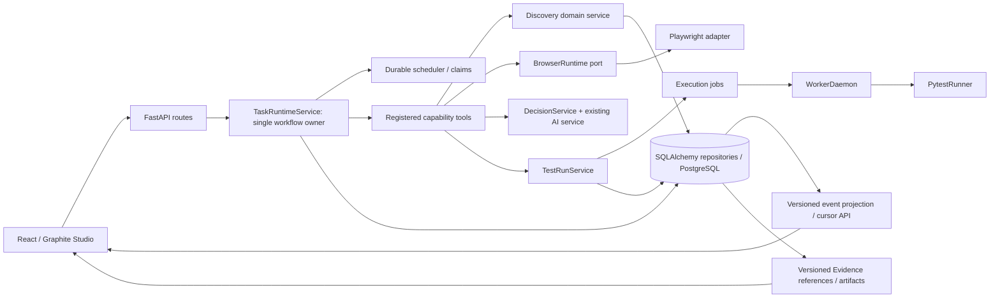

# Target Architecture — Candidate B (Provisional)

**Decision status:** Recommendation for the Phase 5 gate, not an approved production redesign. The gate is currently **DEFERRED**; see `architecture-decisions.md`. This design is intentionally incremental and retains existing FastAPI, React, Pytest, Playwright, SQLAlchemy, services, and data.

## Design goals and non-goals

1. Make task/run state, event replay, and evidence provenance consistent across workflows.
2. Recover only work that is proven safe to resume; never replay an effectful step on ambiguous state.
3. Keep deterministic pytest exit code and recorded execution as the only test verdict authority.
4. Route all browser work through existing `BrowserRuntime`; use existing `DecisionService` and provider registries for advisory reasoning.
5. Preserve existing user-visible API/workflow behavior and data; additive schema/API evolution first.
6. Keep the core locally runnable without paid hosted services, Redis, Kafka, Kubernetes, or other unverified heavy infrastructure.
7. Preserve Desktop First and Graphite boundaries; this document does not propose UI changes.

Out of scope: full system rewrite, replacing React/FastAPI/Pytest/Playwright, launching a general free-form workflow engine, automatic code mutation, unapproved external writes, unattended browser loops, or adopting an agent framework because it is popular.

## Component layout

### Responsibilities and ownership

| Boundary | Target responsibility | Reuse / constraint |
|---|---|---|
| React application | Existing route, context, studio, and runtime projections | Keep current `routes.tsx`, `workspaceContext.ts`, feature API hooks, Graphite UI. Workflow view remains an observer until authoring need is demonstrated. |
| FastAPI routes | Authentication, authorization, schema validation, HTTP transport | Keep current routers and `container.py`; no SQL access in routes. Add fields/endpoints additively. |
| `TaskRuntimeService` | One durable top-level lifecycle for goal/workflow tasks, pause/approval/retry/replan/cancel/recovery | Keep this as the orchestration owner; do not introduce LangGraph/CrewAI as a second scheduler/runtime. |
| Capability services | Browser inspect/act, Discovery, generation, failure repair, and test execution use cases | Retain separate bounded domain services; calls/side effects remain explicit registered tools. |
| `BrowserRuntime` | Sole owner of Playwright startup, sessions, controls, frames, cleanup | Reuse current port and adapter. Browser Use/Skyvern/Stagehand/Midscene must not own a second live browser in production without an approved adapter proof. |
| AI and decisions | Advisory model output, candidate ranking/selection, scenario/test drafts, explanations | Keep `DecisionService`, `AIService`, `AIProviderRegistry`, and `DecisionProviderRegistry` by capability. Persist provider/model/usage/fallback/correlation. AI never sets `PASSED`/`FAILED`. |
| Test execution | Isolated Pytest subprocess, deterministic exit status, artifacts, worker queue | Preserve `TestRunService` and `WorkerDaemon`; strengthen isolation/leases only after threat model and PoC. |
| Persistence | Durable source of truth for task/run/step/evidence/events | Keep SQLAlchemy repositories, PostgreSQL production lane, SQLite local/test lane. Add schema additively; no data deletion during initial rollout. |
| Discovery | Domain-specific observations, product graph, feature/gap projection | Keep `QualityDiscoveryService` calculations and output behavior; move execution ownership fully under Task Runtime only after current fallback and recovery semantics are specified and tested. |

## Shared lifecycle contracts to design

These are target contracts, not current schemas and not authorization to write migrations. Before implementation, make each field/schema explicit in a design and tests.

### `ExecutionRecord` envelope (conceptual)

- Stable `id`, `kind` (`task`, `test_run`, `discovery`, `debug`, etc.), `project_id`, `owner_id`, parent/related IDs.
- Typed `status` by domain plus normalized lifecycle category for cross-page display; never collapse domain-specific terminal meanings into one string without a mapping.
- `created_at`, `started_at`, `updated_at`, `finished_at`, attempt/replan counters, deadline/budget, runtime/worker owner, correlation/request ID.
- Explicit cancellation, pause, approval and recovery semantics.
- `revision` or optimistic concurrency token for commands; state updates are conditional and idempotent.

### `ExecutionEvent` envelope

- Stable per-stream sequence/cursor, `execution_id`, `step_id`, `event_type`, schema version, timestamp, correlation ID, actor/source, bounded/redacted payload.
- Append-only durable events are the replay source. SSE is a projection with `Last-Event-ID`; browser frames are ephemeral evidence samples and do not masquerade as durable events.
- Task event history already has a DB cursor; Discovery `result.events` is bounded JSON and Discovery live seq is process-local. Preserve reads while introducing a versioned adapter; do not silently change existing SSE event names or cursors.

### Evidence contract

- Evidence has stable artifact reference, semantic type, producer/source, owning project/task/run/step, created time, content hash, redaction/retention metadata and verification relation.
- Separate **observations** (DOM/page/API response), **AI interpretations/proposals**, **human approval record**, and **test execution output**.
- AI output is advisory; exact pytest process exit and persisted execution rows determine test verdict.
- Existing `TaskEvidenceORM`, `ArtifactORM`, `TestExecutionORM`, Discovery state/screenshot artifacts, and failure snapshots must map without losing IDs, hashes, ownership, or historical retrieval.

## Runtime lifecycle and recovery target

1. Create request is validated and previewed; mutating work requires explicit user intent, per-action policy and the existing approval boundary.
2. A durable database claim assigns a task/step to one execution owner. Claims have bounded lease/heartbeat, monotonic revision, and idempotency key where duplicate client submission is possible.
3. A retry is allowed only for explicitly retryable, side-effect-safe failure categories; every attempt gets an attempt ID and persisted outcome. Do not retry a browser click, Pytest subprocess, source write, or external integration merely because the process disappeared.
4. Pause stops at a declared safe boundary and stores a snapshot; resume verifies source/workspace/target drift before invalidating/replaying dependent read-only work.
5. Approval references the exact versioned diff/proposal hash, actor, scope and expiry. Stale proposals return conflict; no approval is inferred from model confidence.
6. Restart recovery reconciles DB state with worker/runtime heartbeats. If side effects are ambiguous, transition to `BLOCKED`/operator review, not `RUNNING` or automatic replay. Run/Discovery child records are cross-linked to their parent task.
7. Cancel propagates to an active task, browser session, child test process and execution job; terminal rows cannot be overwritten by late workers.
8. Terminal summary, event cursor and evidence references are read-model projections of persisted records. The React UI never fabricates missing status or evidence.

## Storage and deployment profile

- **Default local profile:** FastAPI + SQLite WAL + local filesystem artifacts + existing Playwright/Chrome + local Pytest worker. No cloud or paid model required for deterministic tests.
- **Production candidate:** PostgreSQL + API + one or more isolated WorkerDaemon replicas + durable filesystem/object storage only after its adapter and ownership semantics are verified. Existing Compose is simpler; no queue broker or orchestration platform is proposed by default.
- API task scheduler ownership and API replica behavior must be explicit before horizontal API scaling. Prefer database claims with leases over sticky `runtime_instance_id` ownership; do not increase replicas until restart/race tests pass.
- Worker processes execute untrusted test code; require OS/container least privilege, workspace-only mounts, outbound network policy, CPU/memory/process limits, and secret isolation before multi-tenant operation. This needs a separate security design and threat-model gate.
- Observability should first standardize correlation IDs, persisted execution/event/evidence links, and metrics on current endpoints. Add a vendor-specific trace backend only if operational need and self-host requirements justify it.

## AI/browser policy

- Deterministic browser operations and tests remain the execution authority; LLM output can suggest a scenario, action candidate, extraction, or explanation only.
- Use observed DOM/accessibility/screenshot evidence as grounding; persist candidate, reason, provider/model, confidence, fallback, token/time usage and verification result.
- Browser actions are bounded by domain policy, action safety, user intent, step/time/token limits and human approval for meaningful external mutation.
- A user-provided requirement or browser page is untrusted input. Never let page content override system safety, leak credentials, or authorize transactions.
- LLM failure is visible and recoverable; no silent Fake provider success path in production.

## Framework integration boundary

No candidate framework is currently approved. If a future PoC demonstrates value:

- The framework must be an **internal adapter/capability** invoked by `TaskRuntimeService`, not a second API-owned loop, scheduler, database, browser session owner, or approval system.
- The platform owns authz, project scope, approval, deterministic test verdict, evidence IDs, costs, redaction, cancellation and audit.
- Pin version, license/SBOM, dependency tree, Python/Playwright compatibility, security posture, memory/CPU/token measurements, upgrade path, and uninstall/replay test before production proposal.
- If it cannot serialize state through the platform’s record contract or safely stop/recover side effects, reject it.

## Expected measurable outcomes (acceptance targets to baseline, not claimed results)

Before each implementation phase, record baseline and falsifiable criteria. At minimum:

- No duplicate active execution for one task/idempotency key, including concurrent requests and API restart.
- All new event IDs/cursors replay without gaps/duplicates; old clients keep working through a compatibility window.
- Every test verdict reconciles with the exact Pytest exit code and `TestExecutionORM`; no AI path changes it.
- Every file/source mutation has an immutable proposal hash and explicit approving actor; stale diff cannot apply.
- Recovery tests cover process death at before/after side effect boundaries and prove no blind replay.
- Evidence retrieval has project ownership checks and stable content hashes.
- Baseline and after measurements report execution duration, provider tokens/cost (if a real provider is used), browser success, flakiness, recovery outcome, and resource consumption; fixture results remain labeled synthetic.
