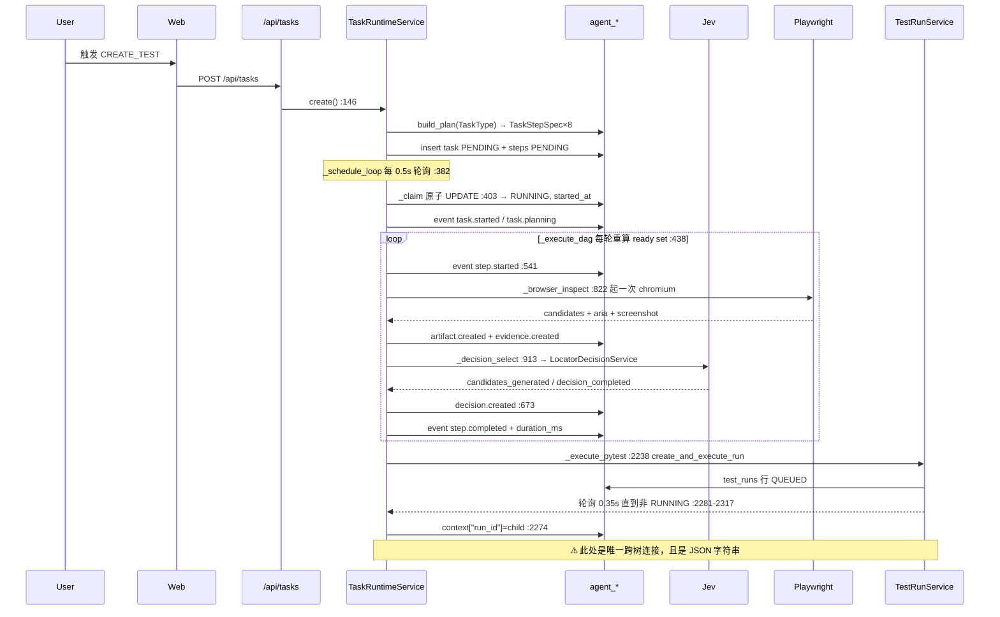
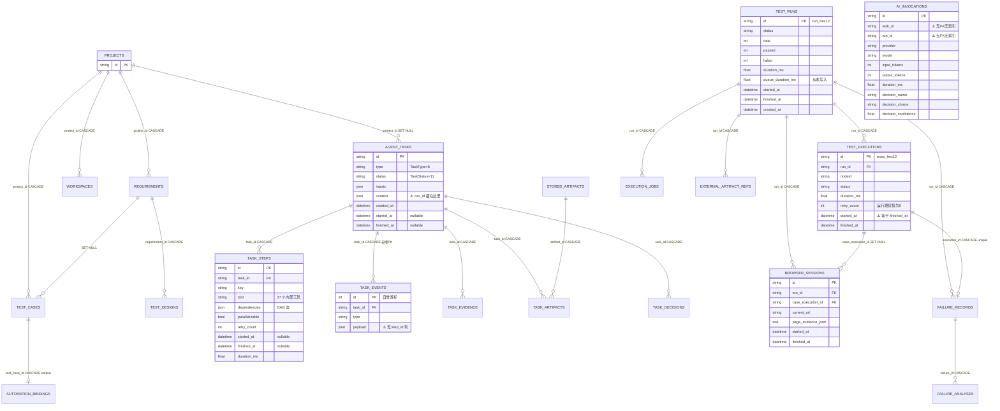
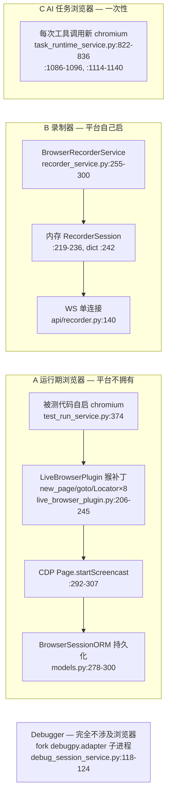
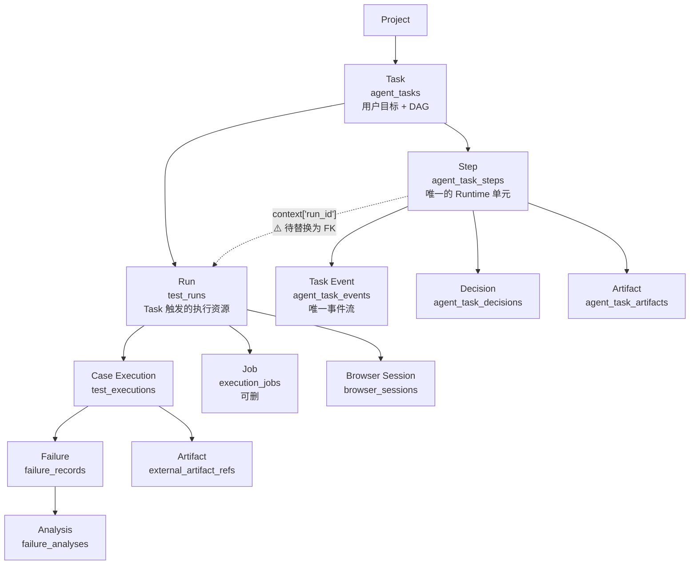
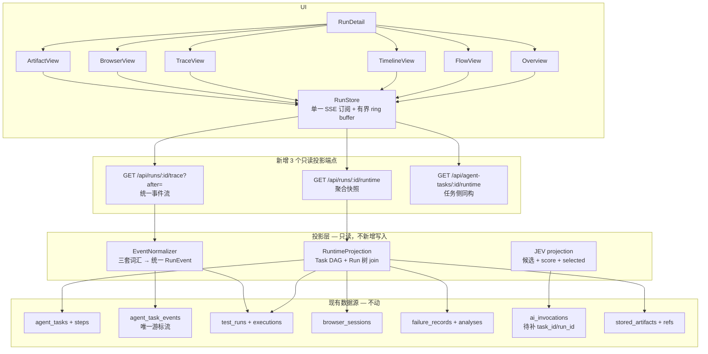

# AI Runtime / Agent Execution Visualization — 改造前审计

> 审计日期：2026-10-02
> 审计范围：`apps/api`、`apps/web`、`apps/worker`、`packages/qa-core`、`packages/project-model`、`packages/integrations`
> 方法：全量代码阅读（backend 32 router / 35 张表 / 2 个调度器；frontend 14 条导航 / 27 条路由 / 全部 SSE 消费点）
> 约束：本轮零业务代码改动，唯一变更为本文件。
> 证据规则：所有结论给 `文件:行号 + 类/方法/组件`。无法从代码确认的写 `UNKNOWN`。

---

# 1 Executive Summary

**一句话**：距离 Runtime Visualization **只差一层统一视图投影，缺的不是能力而是「一个 Run 概念」——当前平台拥有完整的时间轴、事件流、DAG、决策记录、浏览器遥测五要素，但它们分属两棵无外键相连的数据库树，因此无法在同一个页面上拼出「一次任务是怎么执行的」。**

必须避免的误读：平台**不是**「能力很多但只有 Loading」。事实上：

- Agent DAG 调度器**已经存在**且带 ready-set / 环检测 / 并行批 / 重试退避（`task_runtime_service.py:438-499`）
- 事件**已经落库**且支持游标续传（`agent_task_events` 自增主键 + `Last-Event-ID`，`api/tasks.py:143-168`）
- 步骤级 `started_at / finished_at / duration_ms` **已经存在**（`TaskStepORM` `models.py:665-667`）
- JEV 决策的候选、分数、验证、延迟**已经产出**并以 trace 事件广播（`locator_decision_service.py:136-305`）
- 浏览器逐动作遥测（step/network/console + CDP 截帧）**已经存在**（`live_browser_plugin.py:90-173`）

真正的三个断点是：

1. **`agent_tasks` 与 `test_runs` 之间没有任何外键**，唯一连接是 `context["run_id"]` 这个 JSON 字符串（`task_runtime_service.py:2274`）。Timeline 无法跨树。
2. **`test_executions.started_at == finished_at`**（`test_run_repo.py:271-272` 复用同一个 `now` 变量），每用例甘特图时长恒为 0。测试层 Timeline 数据是假的。
3. **没有 Agent 概念**。全仓无任何 Agent 类/注册表/角色；"agent" 仅出现在表名前缀 `agent_*` 与 asyncio task 名字里。Runtime 无对象可画。

---

# 2 Current Architecture

## 2.1 系统全景

```mermaid
flowchart TD
    subgraph WEB["apps/web — React 19 + Vite"]
        NAV["Navigation 14 项扁平侧栏<br/>components/Navigation.tsx:52-76"]
        RP["RunsPage 1131行<br/>内联 SSE switch :160-300"]
        FP["FailuresPage 1121行<br/>诊断 stream :251"]
        TP["TasksPage 176行"]
        LLP["RequirementLifecyclePanel<br/>lifecycle/analyze stream"]
        ULR["useLiveRun.ts 37行<br/>重复的 SSE→state 映射"]
        CG["KnowledgeGraph.tsx<br/>手写 SVG pan/zoom"]
    end

    subgraph API["apps/api — FastAPI, main.py:154-185 注册 32 个 router"]
        AR["/api/tasks  tasks.py:31-168"]
        RR["/api/runs   runs.py:42-113"]
        FR["/api/failures failures.py:54-210"]
        LC["/api/lifecycle lifecycle.py:74-113"]
        QA["/api/qa-assistant qa_assistant.py:25-45"]
        DBG["/api/debugger debugger.py (WS DAP)"]
        REC["/api/recorder recorder.py (WS)"]
    end

    subgraph SVC["services"]
        TRS["TaskRuntimeService<br/>task_runtime_service.py:74<br/>轮询0.5s 并发2"]
        BUS["TestRunEventBus 内存<br/>test_run_service.py:57-118"]
        TRSVC["TestRunService<br/>test_run_service.py"]
        FWS["FailureWorkflowService<br/>线性7阶段 stream()"]
        RLS["RequirementLifecycleService<br/>JSON CAS 写回"]
        DBS["DebugSessionService<br/>内存 dict"]
        RCDS["BrowserRecorderService<br/>内存 dict"]
        DSS["DecisionService → JevDecisionProvider"]
        AES["AIExecutionService<br/>ai_invocations 记账"]
    end

    subgraph DB["persistence — SQLite 文件库, 35 张表"]
        T1["agent_tasks + steps + events<br/>+ evidence + artifacts + decisions"]
        T2["test_runs + executions<br/>+ browser_sessions + failure_records"]
        T3["ai_invocations / stored_artifacts"]
    end

    subgraph EXEC["执行层"]
        PR["PytestRunner<br/>packages/qa-core/execution"]
        LBP["LiveBrowserPlugin<br/>运行时猴补丁"]
        WD["WorkerDaemon<br/>apps/worker 分布式 pytest"]
    end

    NAV --> RP & FP & TP & LLP
    RP --> RR
    ULR --> RR
    FP --> FR
    TP --> AR
    LLP --> LC
    AR --> TRS
    RR --> TRSVC
    FR --> FWS
    LC --> RLS
    TRSP[""] ~~~ TRS
    TRS -->|"_execute_pytest 轮询子 run"| TRSVC
    FWS --> DSS
    TRS --> DSS
    REC --> RCDS
    DBG --> DBS
    TRS --> T1
    TRSVC --> T2
    AES --> T3
    TRSVC --> PR
    PR --> LBP
    PR --> WD
    TRSVC -->|"本地 asyncio task"| PR
    LBP -->|"JSONL 遥测"| TRSVC
    WD -->|"HTTP /api/jobs/{id}/result"| TRSVC
    TRSVC -->|"publish"| BUS
    BUS --> RR
```

## 2.2 真实调用链：用户点「生成测试」



---

# 3 Current Domain Model

## 3.1 实体全景（35 张表，两棵主树）



## 3.2 概念 → 实体映射（哪些真实存在）

| 概念 | 有表? | 落点 | 备注 |
|---|---|---|---|
| Task | ✅ | `agent_tasks` `models.py:616` | agent 目标，与 pytest "test task" 无关 |
| Step | ✅ | `agent_task_steps` `models.py:646` | **唯一带 position+dependencies 的 DAG 节点** |
| Event | ✅ | `agent_task_events` `models.py:723` | 唯一 append-only 游标事件流 |
| Run / TestRun | ✅ | `test_runs` `models.py:214` | |
| Execution | ✅ | `test_executions` `models.py:256` | 一个 nodeid 的单次结果 |
| Job | ✅ | `execution_jobs` `models.py:579` | retry_count/max_retries 是死配置 |
| BrowserSession | ✅ | `browser_sessions` `models.py:281` | 绑 run + execution |
| Artifact | ✅ | `stored_artifacts` `models.py:602` | **零外键孤儿实体** |
| **TaskRun** | ❌ | — | 全仓无此标识符 |
| **Workflow** | ❌ | — | 只有 `FailureWorkflowService` 这类代码编排器 |
| **Node** | ❌ | — | `KnowledgeNode` 是内存图投影 |
| **Runtime** | ❌ | — | 指 `TaskRuntimeService` 进程内调度器 |
| **Agent** | ❌ | — | 见 §6 |
| DebugSession | ❌ | 内存 dict | `debug_session_service.py:92`，重启即丢 |
| RecorderSession | ❌ | 内存 dict | `recorder_service.py:242`，重启即丢 |

## 3.3 三处真正的重复

| 重复内容 | 位置 A | 位置 B | 位置 C |
|---|---|---|---|
| 执行计数 | `test_runs.total/passed/failed` `models.py:231-235` | 实时 `count(TestExecutionORM)` `test_run_repo.py:172-181` | — |
| 决策记录 | `agent_task_decisions` `models.py:706` | `ai_invocations.decision_*` `models.py:397-399` | `agent_task_steps.decision` JSON `models.py:660` |
| Artifact 命名 | `stored_artifacts` | `external_artifact_references` | `TestExecutionORM.artifact_paths` + `FailureRecordORM.screenshot/trace/dom_path` |

## 3.4 最关键的断裂

`agent_tasks` ↔ `test_runs` 之间**零外键**：

| 通道 | 形态 | 证据 |
|---|---|---|
| `agent_tasks.context["run_id"]` | JSON 软链接 | `task_runtime_service.py:2274` 写，`:111`/`:331` 读 |
| `self._child_runs: dict[str,str]` | 进程内字典，重启即丢 | `task_runtime_service.py:89, 2266, 2269` |
| `ai_invocations.task_id/run_id` | String(128) 裸 VARCHAR，无 FK 无 index | `models.py:382-383` |
| `agent_task_evidence.artifact_id` | ✅ 唯一真外键 | `models.py:681` |

---

# 4 Current Navigation

## 4.1 真实路由表（`app/routes.tsx:206-232`）

| path | 行 | 组件 | 备注 |
|---|---|---|---|
| `/` | 206 | DashboardPage | 360 行 |
| `/projects` | 207 | ProjectsPage | |
| `/projects/:projectId` | 208 | ProjectOverviewPage | lifecycle 枢纽，51 行 |
| `/projects/:id/requirements[/:requirementId]` | 209-210 | RequirementsPage | |
| `/projects/:id/test-cases[/:testCaseId]` | 211-212 | TestCasesPage | |
| `/projects/:id/studio` + `/file/*` | 213-214 | AutomationStudioPage | 668 行 + 21 个子组件 |
| `/requirements`, `/test-cases`（非 project 作用域别名） | 215-218 | 同上 | |
| `/runs`, `/runs/:runId` | 219-220 | RunsPage | **1131 行** |
| `/tasks` | 221 | TasksPage | 176 行 |
| `/recorder` | 222 | `<Navigate>` → studio?mode=recorder | 兼容重定向 |
| `/failures[/:failureId]` | 223-224 | FailuresPage | **1121 行** |
| `/flaky` `/quality` `/workers` `/security` `/settings` | 225-229 | 各页 | |
| `/dashboard` → `/`，`/automation` → `/projects` | 230-231 | 重定向 | |

## 4.2 真实导航项（`Navigation.tsx:52-76`）

**14 个平铺项，无分组、无标题、无权限过滤。**

| # | id | 目标 | 图标 |
|---|---|---|---|
| 1 | dashboard | `/` | LayoutDashboard |
| 2 | projects | `/projects` | FolderGit2 |
| 3 | requirements | `${projectBase}/requirements` | FileText |
| 4 | test_cases | `${projectBase}/test-cases` | CheckSquare |
| 5 | automation | `${projectBase}/studio` | Code2 |
| 6 | runs | `/runs` | PlayCircle |
| 7 | tasks | `/tasks` | Workflow |
| 8 | workers | `/workers` | Server |
| 9 | flaky | `/flaky` | Flame |
| 10 | failures | `/failures` | AlertTriangle |
| 11 | quality | `/quality` | ShieldCheck |
| 12 | security | `/security` | Shield |
| 13 | settings | `/settings` | Settings |

`NavTab` 有 14 个成员，其中 `recorder` **没有对应导航项**（只能经 `?mode=recorder` 到达）。

## 4.3 结构问题

- `runs` 与 `tasks` 是**同一个东西的两个视图**，却并列为两个一级入口。
- `workers`（基础设施节点）被夹在 QA 主流程中间（第 8 位）。
- `NavTab → path` 映射重复存在于 `Navigation.tsx:52-76` 的 `to` 与 `navigation.ts:6-36` 的 `pathForTab`，两者当前一致但无任何机制保证。
- `lifecycle.py` 无 prefix 注册（`main.py:164`），拥有 `/api/projects/{id}/knowledge`、`/api/demo-shop/*`、`/api/requirements/{id}/lifecycle/*`，与 `projects.py`/`requirements.py` 概念重叠，解析顺序依赖注册次序。

---

# 5 Existing Capabilities

| Capability | Status | Implementation | Evidence | Reusable | Gap |
|---|---|---|---|---|---|
| DAG 调度器 | ✅ 完整 | `_execute_dag` ready-set + 环检测 + 并行批 | `task_runtime_service.py:438-499` | ✅ 直接复用 | 无 planner，纯静态模板 |
| 计划定义 | ✅ | 6 个 `TaskType` → 硬编码 step 元组 | `task_workflows.py:8-115` | ✅ | 无动态分解 |
| 步骤重试 | ✅ 窄 | 仅 5 个只读工具，退避 ≤3s | `task_runtime_service.py:595-627` | ✅ | pytest 步不在白名单 |
| 人工审批门 | ✅ | `task.request_approval` + `approve()` | `task_runtime_service.py:1681, 277` | ✅ | — |
| 取消 | ✅ | task + step + asyncio task + 子 run 四路 | `task_runtime_service.py:307-340` | ✅ | — |
| 崩溃恢复 | ✅ | `recover_interrupted` → BLOCKED | `task_runtime_service.py:125-144` | ✅ | 不重放副作用 |
| 步骤状态机 | ⚠️ 部分 | 7 状态，无转移校验表 | `task_models.py:37-44` | ⚠️ | 转移散落在服务代码 |
| 持久事件流 | ✅ | 自增 PK + 游标 | `models.py:722-729`, `task_repo.py:201` | ✅ **核心资产** | 无 step_id 列 |
| SSE 续传 | ✅ 唯一端点 | `Last-Event-ID` / `?after=` | `api/tasks.py:155-163` | ✅ | 5/6 端点不支持 |
| 步骤时间轴 | ✅ | started/finished/duration | `models.py:665-667` | ✅ | — |
| 用例时间轴 | ❌ 数据失真 | started==finished | `test_run_repo.py:271-272` | ❌ | 必须修 |
| Run 级时间轴 | ✅ | created/started/finished/duration | `models.py:236-241` | ✅ | — |
| 浏览器遥测 | ✅ 丰富 | step/network/console + CDP 截帧 | `live_browser_plugin.py:90-173` | ✅ | **事件无时间戳** |
| 浏览器会话持久化 | ✅ | `BrowserSessionORM` | `models.py:278-300` | ✅ | — |
| JEV 候选+分数+验证 | ✅ | rank → JEV → Playwright verify | `locator_decision_service.py:80-326` | ✅ | probabilities 被丢弃 |
| 决策记录 | ✅ 三处 | ORM + AI 记账 + trace | `models.py:705, 397, trace.py:12` | ✅ | 前端只渲染 choice |
| AI 调用记账 | ✅ | provider/model/tokens/duration/retry/fallback | `ai_execution_service.py:60-113` | ✅ | **run_id/task_id 从不填** |
| AI trace 事件模型 | ✅ | `AITraceEvent` 13 字段 | `trace.py:12-27` | ✅ **核心资产** | 仅 2 处落库 |
| 证据收集 | ✅ | `FailureEvidenceBundle` | `failure_evidence_service.py:14-72` | ✅ | screenshot/trace 恒 missing |
| Locator 自愈反馈 | ✅ | 4 计数器 + Laplace 平滑 | `locator_history.py:59-105` | ✅ | 单向，无负反馈 |
| Artifact 存储 | ⚠️ | 本地平铺目录，无分片无 TTL | `artifact_storage_service.py:28-48` | ⚠️ | 无查询 API，无 case 关联 |
| 知识图谱投影 | ✅ | 14 类节点 + 16 种关系，读时计算 | `project_knowledge_service.py:29-401` | ✅ **可复用图渲染** | 截断 300 节点 |
| 分布执行 | ⚠️ | WorkerDaemon，但并发实为 1 | `daemon.py:169` | ⚠️ | claim 无 FOR UPDATE |
| 任务重规划 | ✅ | `replan()` 带写保护 | `task_runtime_service.py:342-380` | ✅ | — |
| Run 重试 | ❌ | 无 --reruns，无重入队 | `pytest_runner.py:149-178` | ❌ | retry_count 恒 0 |
| Agent 实体 | ❌ | 不存在 | grep `class \w*Agent\w*` 零命中 | ❌ | 需新建概念 |
| 成本核算 | ❌ | 无价格表无币种字段 | grep `cost\|usd\|price` 零生产命中 | ❌ | 全新 |
| Tool 输入记录 | ❌ | `TaskStepORM.inputs` 恒 `{}` | `task_workflows.py:88-97` 不填 inputs | ❌ | 死字段 |
| 事件虚拟化 | ❌ | 无虚拟列表库，全靠 `.slice(-N)` | `useLiveRun.ts:26-33` | ❌ | 需新建 |

---

# 6 Agent Runtime Audit

## 6.1 事实：没有 Agent

```
grep -rn "class \w*(Agent|Planner|Researcher|Executor|Reviewer|Router)\w*" apps packages
→ 4 命中，其中 3 个是测试替身
```

唯一生产命中是 `ProductionQAOrchestrator`（`orchestrator.py:36`），而它是**无状态单发 prompt 门面**，不是调度器。

"agent" 在本仓库只意味着：

1. 表名前缀 `agent_tasks` / `agent_task_*`（`models.py:616-723`）
2. API tag `tags=["Agent Tasks"]`（`api/tasks.py:23`）
3. asyncio task 名 `agent-task-scheduler` / `agent-task-{id}`（`task_runtime_service.py:97, 393`）
4. git 作者邮箱 `agent@ai-qa.local`
5. 占位模型串 `"fake-qa-agent"`

**最接近「Agent 类型」的是 `TaskType`（`task_models.py:14-20`）6 个值——它们是工作流模板，不是 Agent：没有 per-type 类、没有 per-type 提示词、没有 per-type 工具集、没有 per-type 模型。**

## 6.2 Agent Runtime Capability Matrix

| Capability | Status | Evidence |
|---|---|---|
| Agent 类 / 基类 / 注册表 | **Missing** | grep 零命中；`AIProviderRegistry` (`registry.py:14`) 注册的是 provider |
| 具名 Agent 角色 | **Missing** | 不存在。`TaskType` ×6 是模板 |
| per-Agent 提示词/人设 | Partial | 12 个 `PromptTemplate` + `PROMPT_REGISTRY` (`prompts/__init__.py:193`)，按 feature 而非 agent 索引 |
| 执行单元有持久 ID | Existing | `TaskORM.id` (`models.py:618`)、`TaskStepORM.id` |
| Parent/Child 层级 | **Missing** | grep `parent_id\|subagent\|supervisor` 零命中 |
| DAG 数据模型 | Existing | `TaskStepSpec.depends_on` (`task_models.py:63`) → `TaskStepORM.dependencies` (`models.py:657`) |
| 动态 / LLM 规划 | **Missing** | `build_plan` 是字面量 dict (`task_workflows.py:8-115`)，docstring `:6` 明言「no user-provided tool names」 |
| 并行执行 | Partial（实际失效） | `asyncio.gather` (`task_runtime_service.py:490`) + `Semaphore(2)`；但 `parallelizable` 只给 `source.inspect`/`browser.inspect` (`task_workflows.py:116`)，二者在 6 个模板中从不同为兄弟 → **实际单步串行** |
| 步骤重试 | Existing（窄） | `_execute_step` `:595-627`，白名单 5 个只读工具 |
| 任务重规划 | Existing | `replan()` `:342-380`，写保护 `:355-361` |
| Pause / Resume | **Missing** | `TaskStatus` 无 PAUSED；`WAITING` 仅是审批门 |
| 审批 | Existing | `:1681-1695` + `approve()` `:277-305` |
| Cancel | Existing | `:307-340` 四路取消 |
| 状态机 | Partial | 11 + 7 状态，**无转移校验表** |
| started_at / finished_at | Existing | Task `:418-419, 690`；Step `:526, 690` |
| 步骤 duration_ms | Existing | `:633, 689` |
| 任务总 duration | **Missing** | 只与 `max_duration_seconds` 比较后丢弃 (`:444-451`) |
| 任务级 model 名 | **Missing** | Task/Step 无 model 列；仅 `_call_code_ai` 通过 `step.progress` 泄露 (`task_runtime_service.py:1437-1450`) |
| 单次 AI 调用 model | Existing | `AIInvocationORM.model` (`models.py:386`) |
| Token 用量 | Partial | 调用级有 (`models.py:389-390`)；任务级只有 `context["ai_calls"]` 计数 (`:239, 796-800`) |
| 成本 | **Missing** | grep 零生产命中 |
| 配额 | Existing | `AIBudgetGuard` (`budget.py:11`)；日预算原子预留 (`ai_execution_service.py:41-59`)；`max_ai_calls` (`:789-800`) |
| 工具注册表 | Partial | 27 项 dict 字面量 (`task_runtime_service.py:733-763`)，无 schema/描述/权限声明 |
| LLM 工具调用 | **Missing** | 无 `tools=`/`tool_calls`；`AICompletionRequest` 无 tool 字段 (`ai/models.py:34-46`) |
| 工具输出记录 | Existing | `TaskStepORM.outputs` (`:658`) |
| 工具**输入**记录 | **Missing** | `inputs` 恒 `{}`，`step.started` 回显空 dict (`:541-542`) |
| 工具延迟 | Existing | 步骤 `duration_ms` |
| 结构化子输出 | Existing | `_evidence`/`_artifacts`/`_decision` 约定 (`:646-682`) |

## 6.3 两个互不相关的编排引擎

| 引擎 | 位置 | 模型 |
|---|---|---|
| `TaskRuntimeService` | `task_runtime_service.py:74` | 真 DAG：dependencies / ready-set / 环检测 / 并行批 |
| `FailureWorkflowService.stream()` | `failure_workflow_service.py:104` | 线性 7 阶段硬编码列表 `:163`，无依赖模型 |

两者**不共享类型、不共享事件词汇**。这是统一 Runtime 必须先解决的分叉。

## 6.4 唯一 DAG 引擎的并行为什么失效

```python
# task_runtime_service.py:485-489
if ready[0].parallelizable:
    batch = [step for step in ready if step.parallelizable]
else:
    batch = [ready[0]]
results = await asyncio.gather(*(self._execute_step(task, step) for step in batch), ...)
```

`parallelizable=True` 仅在 `task_workflows.py:116` 赋给 `source.inspect` 和 `browser.inspect`。检查 6 个模板：这两个工具从未同时出现在同一层的兄弟位置。因此 `len(batch)` 恒为 1。

---

# 7 Event System Audit

## 7.1 传输层

| 端点 | 位置 | 命名事件 | `id:` | 续传 | 持久化 |
|---|---|---|---|---|---|
| `GET /api/runs/{id}/events` | `api/runs.py:89-113` | 恒 `message` | ❌ | ❌ | ❌ 靠 DB 重算 |
| `GET /api/tasks/{id}/events` | `api/tasks.py:143-168` | 恒 `message` | ✅ | ✅ | ✅ `agent_task_events` |
| `POST /api/failures/{id}/analyze/stream` | `api/failures.py:94-113` | `= type` | ❌ | ❌ | ✅ `failure_analyses.events` |
| `POST /api/failures/{id}/diagnose-ai/stream` | `api/failures.py:130-153` | `= type` | ❌ | ❌ | ❌ |
| `POST /api/qa-assistant/chat/stream` | `api/qa_assistant.py:25-45` | `= type` | ❌ | ❌ | ❌ |
| `POST /api/requirements/{id}/lifecycle/analyze/stream` | `api/lifecycle.py:74-95` | 恒 `trace` | ❌ | ❌ | ⚠️ 仅 JSON history |
| `WS /api/debug/sessions/{id}/stream` | `api/debugger.py:70` | DAP | — | — | ❌ |
| `WS /api/recorder/sessions/{id}/stream` | `api/recorder.py:140` | 自定义 | — | — | ❌ |
| `WS /api/workspaces/{id}/lsp/stream` | `api/language_service.py:16` | JSON-RPC | — | — | ❌ |

唯一编码器：`event_frame()`（`api/event_stream.py:6-10`）。**从不发 `retry:` 字段**，重连延迟硬编码在前端（`client.ts:189`，500ms→5s）。

## 7.2 真实 Event 全表

### A. Run 流（`message`）
| type | 发射点 | payload |
|---|---|---|
| `CONNECTED` | `test_run_service.py:912` | `run_id` |
| `RUN_STARTED` | `:318` (LOCAL) / `:654` (JENKINS) / `:939` (DB 重算) | `run_id, runner, status, total, job_name?` |
| `LOG_STREAM` | `:341` / `:715` / `:946` | `run_id, log` |
| `TEST_FINISHED` | `:573` / `:950` | `run_id, nodeid, status, duration_ms` |
| `RUN_FINISHED` | `:615` / `:756` / `:963` | `run_id, status, passed, failed, duration_ms, build_url?` |
| `RUN_ERROR` | `:397` / `:783` / `:963` | `run_id, error` |
| `RUN_CANCELLED` | `:820` / `:892` / `:963` | `run_id, reason?` |
| `BROWSER_SESSION` | `:1020` / `:932` | `run_id, session: TestBrowserSession` |
| `BROWSER_TELEMETRY` | `:1040-1048` | `run_id, session_id, channel(console\|network\|step), entry` |
| `BROWSER_FRAME` | `:1051-1066` | `run_id, session_id, mime_type, frame(base64)` |

上游插件事件（`live_browser_plugin.py` → `_record_browser_event` `test_run_service.py:977-1066`）：`session.started` / `navigation` / `session.finished` / `console` / `network` / `step` / `frame`。**全部无时间戳**（`emit()` 只加 `worker_id`，`:40-44`）。

### B. Task 流（`message`，全部落库）
| type | 发射点 | payload |
|---|---|---|
| `task.created` | `task_repo.py:39` | `{type, goal}` |
| `task.started` | `:420` | `{}` |
| `task.planning` | `:421` | `{step_count}` |
| `task.replanning` | `:377` | `{instructions, replan_count}` |
| `task.retrying` | `:623` | `{step_id, retry_count}` |
| `task.cancelled` | `:325, 718` | |
| `task.blocked` | `:141, 298, 720` | |
| `task.completed` / `task.failed` | `:715 / 722` | `{reason, verification}` |
| `step.started` | `:541` | `{step_id, key, tool, input}` |
| `step.progress` | `:557, 1439, 1693, 2276` | **多态**：内层 `type` 区分 `approval.requested` / `ai.call` / `child_run.started` |
| `step.completed` | `:695` | `{step_id, outputs, skipped, duration_ms}` |
| `step.failed` | `:578, 600` | `{step_id, error, retry}` |
| `evidence.created` | `:658` | `{evidence_id, type, step_id}` |
| `artifact.created` | `:664` | `{artifact_id, name, step_id}` |
| `decision.created` | `:675` | `{decision_id, name, choice, provider, confidence}` |
| `ai.trace` | `:1111` | 完整 `AITraceEvent` |

### C. 失败工作流
`workflow.plan`（`failure_workflow_service.py:162`）、`workflow.step` ×7 阶段（`:127`）、`run.completed`（`:350`）、`run.cancelled`（`:361`）、`run.failed`（`:374`）。

### D. 失败 AI 诊断
`analysis_started` `context.loaded` `rule.classified` `evidence_collected` `model.started` `model.completed` `diagnosis_completed` `run.completed` `run.failed`（`failure_service.py:157-347`）。

### E. Locator 决策（嵌套在 C/D 内）
`analysis_started` `evidence_collected` `candidates_generated` `decision_started` `decision_completed` `verification_started` `verification_completed` `diagnosis_completed` `repair_suggested`（`locator_decision_service.py:136-305`）。

### F. QA Assistant
`run.started` `context.loaded` `evidence.collected` `model.started` `model.delta` `model.completed` `validation.started` `validation.completed` `run.completed` `run.failed`（`qa_assistant_service.py:107-317`）。

### G. 需求生命周期
`workflow.step` ×4（context/semantic/decision/coverage）、`run.completed`、`run.failed`（`requirement_lifecycle_service.py:137, 263, 294`）。

## 7.3 现有 Event → 目标 Event 映射

| 目标事件 | 现状 | 差距 |
|---|---|---|
| `run.started` | ✅ run 侧 `RUN_STARTED`；⚠️ task 侧 `task.started` | 命名与载荷不统一 |
| `agent.spawned` | ❌ 无 Agent | 需新建 |
| `agent.started/completed/failed` | ❌ | 可由 step 事件派生，但语义不同 |
| `tool.started` | ⚠️ `step.started` 带 `tool` 名，但无工具入参 | `TaskStepORM.inputs` 恒空 |
| `tool.completed/failed` | ⚠️ `step.completed/failed` | 同上 |
| `decision.created` | ✅ 已有（task 侧） | run 侧无 |
| `browser.started/action/completed` | ⚠️ `BROWSER_SESSION` / `BROWSER_TELEMETRY(step)` | 无时间戳、无 session 生命周期三分 |
| `test.started` | ❌ | 只有 `TEST_FINISHED`；execution 无进行中态 |
| `test.passed/failed` | ✅ `TEST_FINISHED{status}` | — |
| `diagnosis.started/completed` | ⚠️ 失败域有 `analysis_started`/`diagnosis_completed`，task 域完全没有 | 词汇分裂 |
| `fix.started/completed` | ⚠️ 仅 `step.progress{type:approval.requested}` | 无 diff 载荷 |
| `retry.started` | ✅ `task.retrying{step_id, retry_count}` | 无 attempt 序号 |
| `artifact.created` | ⚠️ 仅 task 侧有 | run 侧 `persist_suite_result` 不发事件 |
| `run.completed` | ✅ 三域各有一套（`RUN_FINISHED` / `task.completed` / `run.completed`） | 三套词汇 |

**结论：事件量已经足够（单次 task 典型 40-80 条），缺的是统一词汇表与统一 `run_id` 归属，不是缺事件。**

## 7.4 背压与丢弃

- 订阅队列 `asyncio.Queue(maxsize=32)`（`test_run_service.py:67`）
- 满时**优先级丢弃**：先丢 `BROWSER_FRAME`，再丢 `LOG_STREAM`，保生命周期事件（`:93-118`）
- `_last_frames` 全局 LRU 上限 32 且仅缓存 ≤2MiB（`:83-87`），run 结束清空（`:88-90`）
- Task 流每次拉 250 条，0.5s 轮询，空时 `: keep-alive`（`api/tasks.py:136-139`）
- Failure 工作流队列**无界**（`failure_workflow_service.py:109`），慢客户端会撑内存

## 7.5 重放现状

| 场景 | 现状 |
|---|---|
| Task 刷新页面 | ✅ 完整重放（游标事件表） |
| Run 刷新页面 | ⚠️ 部分——`event_generator` 重算 DB 状态（`:901-975`），但 `log_output` 只保留尾部 20000 字符（`test_run_repo.py:178-189`），`BROWSER_FRAME` **永不重放** |
| 历史 Run Replay | ❌ 只有终态快照 |
| 历史 Task Replay | ⚠️ 事件可重放，但无时间轴对齐（`duration_ms` 只在 step 事件里） |
| 失败分析 Replay | ✅ `failure_analyses.events` 存 JSON 数组，无游标 |
| 需求分析 Replay | ⚠️ 仅 `document.history`（上限 10 条，`lifecycle.py:134`） |

---

# 8 AI Visibility Gap

## 8.1 完全无可见性（只有 boolean spinner）

| 位置 | UI 文案 | 实际后端调用 |
|---|---|---|
| `RequirementAnalysisModal.tsx:37-38` + `useRequirementAI.ts:35-37` | "正在分析需求的可测试性维度…" | `POST /ai/requirements/{id}/analyze` |
| `TestDesignGenerationModal.tsx:40` + `useRequirementAI.ts:49-51` | "正在生成功能/边界/负向/API 测试设计…" | `POST /ai/requirements/{id}/generate-designs` |
| `TestCaseGenerationModal.tsx:47` + `useRequirementAI.ts:81-83` | "正在生成具体用例步骤、前置条件与断言…" | `POST /ai/test-designs/{id}/generate-cases` |
| `AutomationBindingPanel.tsx:110` + `useAutomationBinding.ts:96-97` | "正在生成 Playwright 代码…" | `POST /test-cases/{id}/generate-automation` |
| `SettingsPage.tsx:403` | "正在执行…" | `POST /decision/choose`，结果只显示原始 JSON |
| `RecorderPage.tsx:373` | "正在处理…" | `generate_python_case()` — **纯模板，非 AI** |

**讽刺点**：`POST /requirements/{id}/lifecycle/analyze/stream`（`api/lifecycle.py:74`）已存在且 `RequirementLifecyclePanel.tsx:34` 已消费，但 RequirementsPage 的三个 AI 弹窗仍在走非流式路径——**同一领域两套 UX，一套有 trace 一套只有 spinner**。

## 8.2 有 trace 但被浪费

| 位置 | 问题 |
|---|---|
| `RunsPage.tsx:677` | `ai` tab 显示 `ContextTaskProgress` + 一句 `aiRunExplanation`，**没有 `AIExecutionTimeline`**，而 `TasksPage.tsx` 有 |
| `RecorderPage.tsx:527` | `AIExecutionTimeline running={false}` **硬编码 false**——全应用最好的 JEV 面板永不动 |
| `AIExecutionTimeline.tsx:126` | metadata `<details>` 仅 `import.meta.env.DEV` 渲染 → **生产环境 provider/model/confidence/latency 全部不可见** |
| `TasksPage.tsx:169` | 决策只渲染 `{name}: {choice} ({provider}, {confidence})`，`rationale` 与 `escalated` 丢弃 |
| `AIExecutionTimeline.tsx:80-88` | 有 started 无 completion 且 `running=false` → 永久 pending 点，与「未开始」不可区分 |
| `platform_health_service._jev`（`:95-121`） | Jev 健康已探测已存储，`ReadinessNotice.tsx:12` 只筛 `component === 'ai'`，**jev 被丢弃** |

## 8.3 标签承诺了 AI 但背后没有模型

| 位置 | 标签 | 实际 |
|---|---|---|
| `QualityPage.tsx:451-452` | "正在分析影响…" | `quality_intelligence_service` git-diff 关键词 + binding 匹配，零模型 |
| `studioShell.json:71-72` | "重新生成 AI Summary" | `pr_service.suggest_pr_summary` 字符串模板 |
| `RecorderPage.tsx:373` | "生成脚本" | `generate_python_case()` 模板函数 |
| `qa_core/ai/browser_safety.py:6-33` | 「conservative browser action policy」 | `classify_browser_action` **零调用者** |

## 8.4 核心缺口：AI 调用无法回连 Run

```
decision_service._record()  写 decision_name/choice/confidence，但从不传 run_id/request_id
correlation.py               定义 request_id_context，全仓 1 读 0 写 → request_id 恒 NULL
ai_execution_service.py:66  唯一的读取点
```

结论：**单次 AI 调用的元数据完整，但链路断了**——从 Run 出发无法回答「这次 Run 调了哪个模型、花了多少 token、返回了什么」。

---

# 9 JEV Audit

## 9.1 接入状态：已接入，但默认关闭

| 调用方 | 位置 | 触发 | 是否默认路径 |
|---|---|---|---|
| Locator 修复提案 | `failure_service.py:448` | 用户点「生成 Locator 修复提案」 | 用户主动 |
| 失败分析工作流 | `failure_workflow_service.py:303` | `LOCATOR_CHANGED` 且有候选 | 分类器门控 |
| 需求生命周期 | `requirement_lifecycle_service.py:211` | 2 个 request：`requirement_risk_priority` / `requirement_scenario_priority` | 总是尝试，静默弃权 |
| Agent 任务浏览器探索 | `task_runtime_service.py:978` | `EXPLORE_PAGE` / `RUN_REGRESSION` 到达 decide 步 | ✅ 是 |
| 浏览器录制器 | `recorder_service.py:350, 365` | 每次点击/拾取元素 | ✅ **热路径** |
| 健康探测 | `platform_health_service.py:108` | `GET /ai/system-health` | ✅ |
| Playground | `decision.py:53` | 管理员点「运行决策」 | 仅管理员 |

**门控**：`decision_service.py:121` `if not config.enabled: return self._fallback(request, "provider_disabled")`，`settings.py:37` `jev_enabled: bool = False`。新部署上**所有** JEV 调用返回 `provider="fallback"`，下游静默降级为 Local Strategy，**且代码刻意不报错**。

`apps/worker` 对 `DecisionService` / `jev` / `locator` **零引用**——JEV 不存在于分布式 worker。

## 9.2 目标展示能力 vs 现状

| 需求字段 | 现状 | 证据 |
|---|---|---|
| Question | ✅ | `locator_decision_service.py:167-195` 组装 state |
| Candidates（含 locator + evidence + static_score） | ⚠️ 送到 JEV，本地重排，但**只有 candidate_count + winner 进 trace** | `:236-239` |
| **Score（每个候选的分数）** | ❌ **被丢弃** | grep `probabilities` 仅命中 `decision_service.py:72` 与 `jev_provider.py:97-121`，从不写 ORM |
| Selected action | ✅ | `agent_task_decisions.choice` + `decision.created` 事件 |
| Confidence | ✅ | `models.py:399, 714` |
| Evidence | ⚠️ | 作为 evidence 内容 JSON 落 `agent_task_evidence.content`（`task_runtime_service.py:1063-1077`），无结构化字段 |
| Result（是否验证通过） | ✅ | `LocatorDecisionService.decide` 返回 `verified` + `fallback_reason` |
| Latency | ✅ | `ai_invocations.duration_ms` + trace metadata |
| Fallback | ✅ 但**前端从不显示** | `RecorderPage.tsx:343-345` 只读 engine/model/latency/candidate_id/candidate_count |

**判定**：JEV Decision 可视化 **PARTIAL**。缺的只有一件事——**把每个候选的 score 落库**。这是一次 schema 增量，不是重写。

## 9.3 隐藏的正确性缺陷（影响可视化可信度）

| 问题 | 位置 | 后果 |
|---|---|---|
| JEV 选择若验证失败 → **改写 engine 为 "Local Strategy" 并丢弃 JEV 答案** | `locator_decision_service.py:273-277` | 可视化若只显示 provider=local，用户永远不知道 JEV 其实给出了错答案 |
| 失败工作流调用传 `page=None` | `failure_workflow_service.py:303` | JEV 选择**永远 unverified** |
| `allow_missing_confidence=True` | `locator_decision_service.py:207` | 自信的错答案仍被采信 |
| heal 记账依赖整个 `result` dict 逐字节相同 | `failure_workflow_service.py:72-83` | 并发写会静默丢 heal 记账 |
| `/decision/*` 全部要求 `SECURITY_ADMIN` | `decision.py:23, 33, 42, 51` | 非管理员看不到任何决策 |

---

# 10 Browser Audit

## 10.1 三套互不相通的浏览器栈



## 10.2 Browser 与 Run 的关系

| 问题 | 答案 | 证据 |
|---|---|---|
| 哪个 Run 启动哪个 Session | ✅ 有外键 | `BrowserSessionORM.run_id` → `test_runs` `models.py:284` |
| 哪个 Case | ✅ 有外键 | `case_execution_id` `models.py:285`，运行结束后按 nodeid 回填 `test_run_service.py:509-517` |
| 执行了什么 action | ✅ 有记录 | `page_evidence_json.recent_steps`，每项 `{action, locator, status, duration_ms, file, line}` `live_browser_plugin.py:159-166` |
| 产生了 screenshot | ✅ | `browser-<session_id>-last.jpg` 落盘 `live_browser_plugin.py:330-336`，上传后回填 `last_frame_artifact_id` `test_run_service.py:449-458` |
| 产生了 trace | ❌ | 平台从不生成 trace/HAR/video。`.zip → TRACE` 只是分类猜测 `test_run_service.py:441` |
| 每个 action 有时间戳 | ❌ | `emit()` 只加 `worker_id`，无 time 字段 `live_browser_plugin.py:40-44` |

## 10.3 Browser 是否完全独立

**不是完全独立，但分裂成三处：**

1. 运行期浏览器绑定 Run（`BrowserSessionORM.run_id`），但**浏览器进程不属于平台**——由被测代码自启，平台只通过猴补丁观察。
2. 录制器**完全独立于任何 Run**——纯内存 dataclass，按 owner_id 隔离，`project_id` 仅元数据（`recorder_service.py:219-236`）。API 重启即会话全丢；多副本部署会导致 WS 立即失效。`golden_demo_service.py:278` 甚至直接读 `recorder_service._sessions` 做重置守卫。
3. AI 任务浏览器**每次工具调用新启**，唯一连续性来自 `_recorder_storage_state()`（`task_runtime_service.py:771-781`）注入 cookies/localStorage。

## 10.4 Browser 会话隔离代价

无跨 run 浏览器池，但同一时刻可能存在 N 个互不感知的 Chromium（录制器会话数 + AI 任务并发 + 每个 xdist worker 的测试浏览器 + 每次诊断一个）。录制器无并发上限、无 TTL、无资源配额。

---

# 11 TestRun Audit

## 11.1 端到端链路

| # | 环节 | 位置 |
|---|---|---|
| 1 | `POST /api/runs` | `api/runs.py:49-54` |
| 2 | `create_and_execute_run` | `test_run_service.py:252-262` |
| 3 | 建行（`id=run_<hex12>`，QUEUED） | `test_run_repo.py:55-81` |
| 4 | 三路分发 JENKINS / WORKER / LOCAL | `test_run_service.py:271-293` |
| 5 | QUEUED→RUNNING CAS + `started_at` | `test_run_repo.py:124-159` |
| 6 | **进程 spawn** `create_subprocess_exec` | `pytest_runner.py:218` |
| 7 | 结果落库 `persist_suite_result` | `test_run_service.py:406-624` |
| 8 | 终态判定（严格按 exit code） | `test_run_service.py:585` → `_verdict:837-850` |

## 11.2 关键数据缺陷

| 缺陷 | 证据 | 影响 |
|---|---|---|
| **`test_executions.started_at == finished_at`** | `test_run_repo.py:271-272` 复用同一 `now` 变量 | 用例甘特图时长恒为 0 |
| **`retry_count` 运行路径恒为 0** | `test_run_service.py:498-507` 未传；`test_run_repo.py:266` 默认 | 无法显示「第 2 次尝试」 |
| **无 `--reruns`** | `pytest_runner.py:149-178`；全仓无 `pytest-rerunfailures` | 无自动重试 |
| **无进行中 execution 态** | execution 只在 run 结束时批量写入 | 无法实时显示 `test.started` |
| **每用例无独立 stdout/stderr** | `SingleTestResult` 有字段但 runner 从不赋值（`pytest_runner.py:298-311`）；stderr 合并进 run 级 log | 定位困难 |
| **`log_output` 只留尾部 20000 字符** | `test_run_repo.py:178-189` | 早期日志永久丢失 |
| **`queue_duration_ms` 从未写入** | 仅 `test_run_service.py:200` 读取 | 队列耗时不可见 |
| **artifact 仅单用例时挂到 execution** | `test_run_service.py:506` `if len(results)==1` | 多用例时用例级产物为空 |
| **`failure_records.screenshot/trace/dom_path` 恒 NULL** | `test_run_service.py:530-544` 调用时未传 | 失败记录与产物**当前断链** |
| **execution → case 无 FK** | 靠 `(nodeid, workspace_id)` 字符串相等 `project_knowledge_service.py:76-82` | 脆弱 |

## 11.3 TestRun ↔ TaskRun 关系

**完全没有数据库级关系，只有一处 JSON 字符串。**

| 方向 | 通道 | 证据 |
|---|---|---|
| Task → Run | `context["run_id"]` JSON | `task_runtime_service.py:2274` |
| Task → Run（内存） | `self._child_runs` dict | `task_runtime_service.py:89, 2266, 2269` |
| Task → Run（事件） | `step.progress{type:"child_run.started", run_id}` | `task_runtime_service.py:2276` |
| Run → Task | ❌ **不存在任何路径** | — |

设计意图写在 ORM docstring 里：`TaskORM` "Test runs and worker jobs remain execution resources below a task"（`models.py:613`）——**Task 在上、Run 在下的层级是对的，只是没实现**。

---

# 12 Debugger Audit

| 问题 | 答案 | 证据 |
|---|---|---|
| Debugger 属于一次 Test Run 吗 | ❌ 不是 | `DebugSessionCreate{workspace_id, nodeid}` `models.py:421-423`，无 run_id / failure_id |
| 会话持久化 | ❌ 纯内存 | `debug_session_service.py:92` `self._sessions: dict`，重启即丢 |
| 附加对象 | pytest nodeid（服务端强制） | `debug_session_service.py:155-170` 覆盖 launch 参数为 `["-p","no:xdist","-s","-q",nodeid]` |
| Failure → Debugger 链接 | ⚠️ 仅「自动断点」间接链 | `test_run_service.py:546-570` 写 `BreakpointORM(source="auto_failure", run_id=...)`；`FailuresPage.tsx:172-183` 按 `source==='auto_failure' && run_id===failure.run_id` 找行号 |
| Debugger → Browser | ❌ **完全割裂** | debugpy 拉起的新 pytest 会开一个平台看不见的新浏览器，不产生 `BrowserSessionORM` |
| 调试输出持久化 | ❌ | debugpy stderr 直接丢弃（`debug_session_service.py:239-243`），stdout 只在内存队列 |
| Pause at breakpoint | ✅ | DAP 白名单 16 命令 `:17-33` |

**Runtime 能否呈现 `Failure → Debugger → AI Diagnose → Fix → Retry`？**
不能。目前只有 `Failure → Fix → Retry` 有数据链（`failure_service.apply_repair:650` + `attach_verification:31-45`），`Debugger` 这一环在数据上是断的。

---

# 13 Artifact Audit

## 13.1 当前模型

`stored_artifacts`（`models.py:601-610`）：`id / filename / size_bytes / content_type / storage_type / storage_path / created_at`。

**零外键孤儿实体。** 三处侧面链接：

| 链接 | 机制 | 证据 |
|---|---|---|
| run → artifact | `external_artifact_references.run_id` FK + `metadata_json["artifact_id"]`（**字符串非 FK**） | `models.py:454-465` |
| run → artifact（松） | `test_executions.artifact_paths`（URL 列表，仅单用例时填） | `models.py:267` |
| task → artifact | `agent_task_artifacts.artifact_id` FK CASCADE | `models.py:689-701` |
| case → artifact | ❌ **无** | grep 无 `TestCaseORM.artifact_id` |

存储：`runtime/artifacts/{uuid4hex}_{filename}`，平铺、无分片、无 per-run 子目录、无 TTL（`artifact_storage_service.py:39`）。S3 只有字段无实现（`:16-17` docstring 自述）。

API 只有 3 个端点：`POST /upload`、`GET /{id}/info`、`GET /{id}/download`（`api/artifacts.py:12-41`）。**无列表、无按 run 分组、无元数据过滤**。

## 13.2 真实产出的 Artifact 类型

| # | 类型 | 产出点 | 记录的 kind |
|---|---|---|---|
| 1 | `browser-<session_id>-last.jpg` | `live_browser_plugin.py:330-336` | `SCREENSHOT` |
| 2 | 任意 `image/*` | 用户 conftest → `test_run_service.py:436-440` | `SCREENSHOT` |
| 3 | 任意 `.zip` | 同上 `:441` | `TRACE` |
| 4 | 其他 | 同上 `:442` | `REPORT` |
| 5 | `page.png` | `task_runtime_service.py:861` | `SCREENSHOT` |
| 6 | `observe-<n>.png` | `task_runtime_service.py:1178-1184` | `SCREENSHOT` |
| 7 | 生成的 pytest 源码 | `task_runtime_service.py:1497-1499` | `GENERATED_TEST` |
| 8 | 重构/修复提案 | `task_runtime_service.py:1738-1740, 2038-2040` | `PATCH_PROPOSAL` |
| 9 | Jenkins Allure/HTML（URL） | `test_run_service.py:732-739` | `ALLURE` / `HTML_REPORT` |

**不存在的类型**：video、HAR、DOM dump 文件、network log 文件、独立 HTML 报告、unified diff 文件。`docs/WORKSPACE_MODEL.md:22` 与 `docs/RUNNER_ARCHITECTURE.md:29-30` 声称存在 video/trace/DOM artifact——**这是文档声明，与代码矛盾**。

`EvidenceType.SCREENSHOT / PLAYWRIGHT_TRACE / GIT_DIFF`（`task_models.py:47-50`）只是 `agent_task_evidence.content` 的文本行，不是 artifact。

## 13.3 未来 Artifact 归类评估

| 候选 | 是否应作为 Artifact | 判断 |
|---|---|---|
| Requirement Map | ✅ 应是 | 现为 `GET /projects/{id}/knowledge` 的即时投影，**每次请求重算**（10 次查询 + 最多 300 节点）。必须快照化 |
| Test Knowledge Map | ✅ 应是 | 同上 |
| Test Plan / Test Design | ⚠️ 已经是实体 | `TestDesignORM`（`models.py:131`），不必重复造 artifact |
| Generated Cases | ⚠️ 已经是实体 | `TestCaseORM` + `GENERATED_TEST` artifact 并存，建议保留 artifact 作为代码快照 |
| Code Changes / Diff | ✅ 应是 | 现在只有 `PATCH_PROPOSAL` 文件，**无 unified diff artifact** |
| Browser Evidence | ✅ 应是 | 现在散在 `browser_sessions.page_evidence_json` + 孤立 screenshot |
| Test Report | ⚠️ 已经是实体 | `external_artifact_references` |
| Acceptance Report | ❌ 不该是 | 应是 Run 的 `verification` 字段（`TaskORM.verification` 已存在） |

**判定：Artifact Center 可行，但必须先做「统一 artifact↔run↔step↔case 关联」，否则只是把三张孤儿表拼在一起。**

---

# 14 Timeline Feasibility

## 判定：**PARTIAL — 需要后端补 3 项数据，两棵树各自可做，合并不可做**

## 14.1 字段矩阵

| 实体 | created_at | started_at | finished_at | duration_ms | 可画条 |
|---|---|---|---|---|---|
| `TaskORM` `models.py:639-641` | ✅ idx | ✅ | ✅ | ❌ 只有预算 | ✅ |
| `TaskStepORM` `models.py:665-667` | ❌ | ✅ | ✅ | ✅ | ✅ |
| `TestRunORM` `models.py:239-241` | ✅ idx | ✅ | ✅ | ✅ +`queue_duration_ms` | ✅ |
| `TestExecutionORM` `models.py:268-269` | ❌ | ⚠️ **等于 finished** | ⚠️ | ✅（真实，来自 pytest report） | ❌ **数据失真** |
| `ExecutionJobORM` `models.py:595-597` | ✅ idx | ✅ | ✅ | ✅ | ✅ |
| `BrowserSessionORM` `models.py:296-297` | ❌ | ✅ 非空 | ✅ | ❌ | ✅ |
| `FailureRecordORM` `models.py:344` | ✅ | ❌ | ❌ | ❌ | ❌ |
| `AIInvocationORM` `models.py:387-388` | ✅ idx | ✅ 非空 | ❌ | ✅ | ✅ |
| `TaskEventORM` `models.py:725-729` | ✅ idx | — | — | — | 只能当刻度 |

## 14.2 缺什么

| 缺失 | 影响 | 修法 |
|---|---|---|
| `test_executions.started_at == finished_at` | 用例甘特全为 0 | pytest report 插件记录 per-test wall-clock；或执行行先插入 RUNNING 行再更新 |
| `test_runs ↔ agent_tasks` 无 FK | 跨树合并不可行 | 加 `test_runs.task_id` FK（推荐，见 §22） |
| 无 `attempt` 行 | 无法展开「第 N 次重试」 | `test_executions` 加 `attempt` 列；或新增 `run_attempts` 表 |
| `agent_task_events` 无 `step_id` 列 | 事件需解 JSON 才能归步骤 | 加 `step_id` 列 |
| `browser telemetry` 无时间戳 | 浏览器动作无法定位到时刻 | 插件 `emit()` 加 `timestamp` |
| `failure_records` 无时间区间 | 失败点无法定位 | 加 `occurred_at` 或用 `created_at` 近似 |
| `ai_invocations.task_id/run_id` 从不填 | AI 调用无法回连 Run | 调用方传参 |

## 14.3 结论

- **Task 侧 Timeline：READY**，只需 API 聚合（`agent_tasks` JOIN `agent_task_steps`），无后端改动。
- **Run 侧 Timeline：PARTIAL**，需修 `test_executions` 时间戳。
- **统一 Timeline（Task + Run 同一视图）：NOT READY**，需加 FK。
- **Replay Timeline：NOT READY**，`agent_task_events` 可重放但无 span 结构（见 §17）。

---

# 15 Dynamic Graph Feasibility

## 判定：**READY — 已存在 DAG，不要造第二套**

## 15.1 现有可复用资产

| 资产 | 位置 | 能力 |
|---|---|---|
| `TaskStepORM.dependencies` | `models.py:657` | JsonList 存 step key |
| `_execute_dag` ready-set 计算 | `task_runtime_service.py:456-482` | 依赖满足、环检测、父失败传播 |
| `build_plan` 模板 | `task_workflows.py:8-115` | 6 套已验证 DAG |
| `visibleGraph` / `layoutGraph` | `graphModel.ts:4-26` | 折叠、过滤、布局 |
| `KnowledgeGraph` | `KnowledgeGraph.tsx` | 手写 SVG 贝塞尔边 + 绝对定位节点 + pan/zoom/fold + 节点检查器 |
| `ProjectKnowledgeService` | `project_knowledge_service.py:29-401` | 14 类节点 + 16 种关系的实体级图 |

## 15.2 节点/边现状

| 需要 | 现状 |
|---|---|
| node id | ✅ `TaskStepORM.id` / `key` |
| parent id | ✅ `dependencies`（key 引用） |
| dependency | ✅ 同上 |
| DAG | ✅ `_execute_dag` |
| step relation | ✅ 同上 |
| **agent relation** | ❌ 无 Agent 概念 |
| **run↔step 关系** | ❌ 无 FK |
| 节点状态集 | ✅ `TaskStepStatus` ×7 |

## 15.3 Flow View 依赖评估

| 需求 | 现状 |
|---|---|
| 动态反映真实执行路径 | ✅ DAG 是数据驱动的（`dependencies` 从 DB 读，`_execute_dag:453`） |
| 节点状态 queued/running/completed/failed/retrying/waiting | ⚠️ 现有 7 态：`PENDING/RUNNING/WAITING_FOR_APPROVAL/COMPLETED/FAILED/SKIPPED/CANCELLED`。缺 `retrying`（在 task 级）、`waiting` 可映射 `WAITING_FOR_APPROVAL` |
| 边只画真正走过的 | ⚠️ `_execute_dag` 不记录「跳过/未走」的边 |
| React Flow / XYFlow | ❌ **未安装**。`apps/web/package.json:13-22` 只有 monaco / i18next / lucide / react / react-dom / react-i18next / react-router-dom。grep `reactflow\|xyflow\|dagre\|d3\|cytoscape\|elkjs` 零命中 |
| 现有图能力 | ✅ `KnowledgeGraph.tsx` 已实现 pan/zoom/fold/检查器，但布局是 14 类固定列网格（`graphModel.ts:24`），**不适合执行图** |

**结论：图数据 READY，图渲染 PARTIAL。** 需要一个分层布局算法（现有的列网格不能复用），但可以复用 `KnowledgeGraph` 的交互与检查器模式。

---

# 16 Trace Feasibility

## 判定：**READY — 这是平台最成熟的资产**

## 16.1 现有 Trace 模型

`AITraceEvent`（`trace.py:12-27`）13 字段：`run_id / case_execution_id / step_id / event_id / type / timestamp / status / duration_ms / stage / title / message / metadata / content`。

- `metadata` 与 `content` 在 validator 层自动脱敏（`:29-40`）
- 已覆盖目标 Trace 的几乎全部条目：AI stage / tool call / JEV decision / browser action / test event / failure / diagnosis / fix / retry

## 16.2 目标 Trace 条目 vs 现状

| 目标条目 | 现状 | 证据 |
|---|---|---|
| `10:42:01 Requirement analysis started` | ✅ `workflow.step{stage:"context"}` 带 `timestamp` | `requirement_lifecycle_service.py:137` |
| `project.search → 7 files` | ❌ 无 tool 调用事件 | `step.started` 带 tool 名但无入参 |
| `JEV decision → inspect browser` | ✅ `decision.created` + `decision_completed` | `task_runtime_service.py:675`；`locator_decision_service.py:226` |
| `Browser navigate → /checkout` | ⚠️ `BROWSER_TELEMETRY{channel:"step"}` 但**无时间戳** | `live_browser_plugin.py:40-44` |
| `Pytest started` | ⚠️ 只有 `RUN_STARTED`（run 级） | `test_run_service.py:318` |
| `Assertion failed` | ✅ `TEST_FINISHED{status, duration_ms}` | `:573` |
| `AI diagnosis started` | ✅ `analysis_started` | `failure_service.py:158` |
| `Locator stale detected` | ✅ `evidence_collected` | `locator_decision_service.py:143` |
| `JEV → locator heal` | ✅ `decision_completed{metadata.selected_action}` | `:226-240` |
| `Retry` | ✅ `task.retrying` | `task_runtime_service.py:623` |
| `Passed` | ✅ `TEST_FINISHED` + `task.completed` | — |

## 16.3 唯一硬约束

**不暴露 CoT**：`content` 字段虽存在，但生产环境必须只放 summary。当前 `AIExecutionTimeline.tsx:126` 的 metadata `<details>` 仅 DEV 渲染——这个决定应保留并强化为「白名单字段渲染」。

**结论：Trace 视图是 5 个视图中最便宜的——数据 90% 已有，缺的是统一 `run_id` 与时间戳对齐。**

---

# 17 Replay Feasibility

## 判定：**PARTIAL — Task 侧可重放，Run 侧只能重算，历史侧无**

## 17.1 现状

| 场景 | 现状 | 证据 |
|---|---|---|
| 刷新页面恢复 Task | ✅ 完整 | 事件表 + `Last-Event-ID`（`api/tasks.py:155-163`） |
| 刷新页面恢复 Run | ⚠️ 重算非重放 | `event_generator:901-975` 每 0.2s 重读 DB |
| Run 历史 Replay | ❌ | 只有终态快照 |
| Task 历史 Replay | ⚠️ 事件可拉但无时间轴 | `duration_ms` 只在 `step.completed` 事件里（`:696`） |
| 失败分析 Replay | ✅ | `failure_analyses.events` JSON 数组，无游标 |
| 需求分析 Replay | ⚠️ 上限 10 条 | `document.history` `lifecycle.py:134` |
| 跨进程事件 | ❌ | `TestRunEventBus` 是模块级内存（`test_run_service.py:120`） |

## 17.2 Live / Replay 共用 UI 的前提

| 前提 | 状态 |
|---|---|
| 同一事件 schema 驱动两种模式 | ❌ 三套词汇（`RUN_*` / `task.*`+`step.*` / `workflow.*`+`run.*`） |
| 事件可按时间排序 | ⚠️ Task 侧靠自增 id；Run 侧靠轮询顺序 |
| 事件有绝对时间戳 | ⚠️ Task 侧有 `created_at`；Run 侧 `BROWSER_*` 无 |
| 事件可限速回放 | ❌ 无 replay 控制接口 |

**结论：Replay 需要先统一事件 schema + 给 Run 事件加 `id:`/时间戳。Task 侧的 Replay 路径已验证可行，可作为实现范式。**

---

# 18 UX Friction Map

## 场景 A：Requirement → AI 分析 → 生成 Case → 生成代码 → Run → Result

| 步 | 页面 | 问题 |
|---|---|---|
| 1 | `/projects` → 选项目 | — |
| 2 | `/projects/:id/requirements` | — |
| 3 | AI 分析 | ⚠️ **两个入口**：`RequirementLifecyclePanel`（有 trace 7 阶段）vs `RequirementAnalysisModal`（只有 spinner）。用户可能点后者 |
| 4 | 生成 Design | ⚠️ `TestDesignGenerationModal`，spinner |
| 5 | 生成 Case | ⚠️ `TestCaseGenerationModal`，spinner |
| 6 | 生成代码 | ⚠️ `AutomationBindingPanel`，spinner |
| 7 | Run | ⚠️ 需回到 `/projects/:id/studio` 或 `/runs` |
| 8 | Result | `/runs/:runId` |

**页数：6-7 跳。上下文丢失：1 处（步骤 3 的双入口）。Loading 黑洞：4 处。**

## 场景 B：已有 Test → Run → Fail → AI Diagnose → Fix → Retry → Pass

| 步 | 页面 | 问题 |
|---|---|---|
| 1 | Studio 点 Run | `useRunExecution` 只做 1.5s 轮询（`useRunExecution.ts:20`），**不开 SSE**，无实时输出 |
| 2 | 结果 | ⚠️ 必须离开 Studio 去 `/runs/:runId`（`RunOutputPanel` 的 `onNavigateToRuns`） |
| 3 | 失败 | `/runs` → 找到失败 → 点失败跳 `/failures/:failureId` |
| 4 | AI Diagnose | ✅ `FailureWorkflowPanel` 7 阶段 trace，**这是全应用最好的 AI 可视化** |
| 5 | Fix | ⚠️ `generate_repair_proposal` 独立按钮，无诊断→修复的自动串联 |
| 6 | Retry | ⚠️ `handleRerunTest` 创建**一次无关联的新 Run**：`TestRunORM` 无 `parent_run_id` / `origin_failure_id` |
| 7 | Pass | ⚠️ 需手动 `attach_verification`（`failures.py:83-92`），UI 有按钮但用户不知道要点 |

**页数：5 跳（Studio → Runs → Failures → Studio → Runs）。上下文丢失：3 处。核心断裂：重试 Run 与原 Run 无数据关联，修复→验证链只能靠 nodeid 字符串匹配事后拼。**

## 场景 C：Browser → Recorder → Generate Test → Import → Run

| 步 | 页面 | 问题 |
|---|---|---|
| 1 | `/projects/:id/studio?mode=recorder` | 需手动切 mode tab（`routes.tsx:100`） |
| 2 | 录制 | ⚠️ 会话纯内存，断线恢复靠 localStorage（`RecorderPage.tsx:198-206`） |
| 3 | 生成代码 | ⚠️ `POST /generate` 返回字符串，前端调 **4 个接口**（写文件→建用例→建绑定→建 Run） |
| 4 | Run | ✅ |
| 5 | Result | — |

**页数：3 跳（但都在 Studio 内）。上下文丢失：0 处（RecorderPage 保持 runId）。真实问题：录制过程本身**完全不留档**——服务端零制品、零 DB 记录。**

## 场景 D：失败 Case → Debugger → 修改 → Retry

| 步 | 页面 | 问题 |
|---|---|---|
| 1 | `/failures/:failureId` | — |
| 2 | 「在 Studio 中打开」 | `FailuresPage.tsx:172-183` 按 `source==='auto_failure'` 找行号 |
| 3 | Studio 启动调试 | ✅ DAP over WS，断点从 DB 读 |
| 4 | 修改 | ✅ Monaco + 自建 LSP |
| 5 | Retry | ⚠️ 回到步骤 1 或去 `/runs` 新建 Run |

**页数：3 跳。上下文丢失：1 处（`BreakpointORM.run_id` 是唯一 run↔debug 关联，但 debug 服务从不读它）。**

## 汇总摩擦点

| 摩擦 | 出现场景 | 根因 |
|---|---|---|
| `runs` 与 `tasks` 是同一个东西的两个一级入口 | A,B,C,D | 概念未统一 |
| 4 处 AI spinner | A | 3 个弹窗未接已有 stream |
| 重试 Run 与原 Run 无关联 | B,D | `test_runs` 无 `parent_run_id` |
| Run 实时视图有两套实现 | B | `RunsPage.tsx:160-300` vs `useLiveRun.ts:26-33` |
| Studio 内运行无实时输出 | B | `useRunExecution` 只轮询不开流 |
| 修复→验证需手动点按钮 | B | `attach_verification` 是孤立端点 |
| 录制不留档 | C | `RecorderSession` 纯内存 |

---

# 19 Duplicate Concepts

| 概念对 | 重叠内容 | 判定 | 处置建议 |
|---|---|---|---|
| **Task ↔ Run** | 两者都有 status/timestamps/DAG/事件，但分属两表无 FK | **不是重复，是层级缺失** | 保留两者，补 `test_runs.task_id` FK |
| **Run ↔ Workflow** | `FailureWorkflowService` 的 7 阶段被称为 workflow，实为线性 stage 列表 | **真重复** | 阶段化表达统一到 Runtime 的 step 视图 |
| **Run ↔ Execution ↔ Job** | `test_runs` / `test_executions` / `execution_jobs` 三层 | **语义合理，但 Job 层几乎是死的** | `execution_jobs.retry_count`/`max_retries` 死配置，应删或实现 |
| **Agent Workflow ↔ Task** | 「Agent Workflow」= `agent_tasks`；没有独立的 Workflow 实体 | **无重复** | — |
| **Automation Studio ↔ Studio Run Panel** | `StudioRunPanel.tsx` 22 行复刻 `RunsPage` 的 8 tab | **真重复** | 合并为一个 `RunDetail`，Studio 内嵌 |
| **RunsPage ↔ useLiveRun** | 同一套 SSE→state 映射两份实现 | **真重复** | 提取为单一 hook |
| **Browser ↔ Run** | 运行期已绑定；录制器完全独立 | **部分重复** | 录制器需纳入 Runtime 记录 |
| **Debugger ↔ Failure** | 无数据关联 | **应合并但未做** | `debug_sessions` 表 + `failure_id`/`run_id` |
| **Failures ↔ Tasks** | FIX_FAILURE task 与 failure 分析是两套链路 | **真重复** | 统一到 Task 视图 |
| **JEV decision ↔ TaskDecision ↔ AIInvocation.decision_*** | 决策存三处 | **真重复** | 收敛到一处 |
| **KnowledgeGraph ↔ Runtime Graph** | 都会画节点+边 | **不是重复** | 复用渲染交互，不复用布局 |
| **`RequirementDetail.tsx`** | 83 行，全仓零 import | **死代码** | 删除 |
| **`TestDesignPanel.tsx`** | 仅 `!selectedReq.qa_model` 时可达，被 `RequirementLifecyclePanel.design` tab 取代 | **准死代码** | 合并 |

---

# 20 Recommended Information Architecture

## 20.1 目标结构

**不新增一级导航，合并现有入口。**

```mermaid
flowchart TD
    ROOT["Sidebar 缩减为 7 项"]

    ROOT --> DASH["Dashboard /"]
    ROOT --> PROJ["Projects /projects"]
    ROOT --> RUNS["Runs /runs<br/>原 tasks + runs 合并"]
    ROOT --> REQ["Requirements"]
    ROOT --> CASES["Test Cases"]
    ROOT --> STUDIO["Studio"]
    ROOT --> INFRA["Platform<br/>原 workers+security+settings+flaky+quality 折叠"]

    PROJ --> POV["ProjectOverviewPage<br/>Journey + KnowledgeGraph + Coverage"]

    RUNS --> RL["RunList"]
    RUNS --> RD["RunDetail /runs/:runId"]
    RD --> OVR["Overview<br/>状态/进度/耗时/产物计数"]
    RD --> FLOW["Flow<br/>复用 TaskStep DAG"]
    RD --> TLM["Timeline<br/>甘特"]
    RD --> TRC["Trace<br/>AITraceEvent"]
    RD --> BROWSER["Browser<br/>复用 LiveBrowserPanel"]
    RD --> ART["Artifacts<br/>复用现有下载"]

    REQ --> RLP["RequirementLifecyclePanel<br/>已有 7 tab 保留"]
    CASES --> TCP["TestCasesPage<br/>已有详情保留"]

    STUDIO --> CODE["AutomationStudio"]
    STUDIO --> REC["Recorder<br/>已有"]

    INFRA2[""] ~~~ INFRA
    INFRA --> WORKERS["Workers"]
    INFRA --> QUALITY["Quality/Flaky"]
    INFRA --> SEC["Security"]
    INFRA --> SET["Settings"]
```

## 20.2 导航变更

| 现状 | 目标 | 理由 |
|---|---|---|
| 13 项平铺 | **7 项 + 1 折叠组** | 减少认知负担 |
| `runs` 与 `tasks` 并列 | 合并为 **`runs`** | 同一个东西的两个视图 |
| `workers` 夹在第 8 位 | 移入 **Platform 折叠组** | 基础设施不是 QA 主流程 |
| `flaky` `quality` `security` `settings` 平铺 | 折叠为 **Platform** | 管理类，非流程类 |
| `automation` → studio | 保留但改名 **Studio** | — |

## 20.3 Runtime 作为 Run 的观察方式，不是新模块

**明确采纳题目建议的结构**，理由：`TaskORM` 与 `TestRunORM` 是同一件事的两层（Task 在上，Run 在下，ORM docstring `models.py:613` 自述），Runtime 视图必须同时呈现两者，所以它不能是 Run 的 tab——**它需要同时挂在 Task 与 Run 上**。

修正后的模型：



**关键设计决策**：`Step` 是唯一的 Runtime 单元。Task 步骤与 TestRun 是**兄弟**（Task 步骤 vs 执行资源），不是父子。这与当前 `_execute_pytest` 把 Run 当工具调用的实现一致（`task_runtime_service.py:2238`）。

---

# 21 Recommended Runtime Architecture



## 21.1 核心原则

1. **投影层只读**：不改任何写入路径，只把已有数据 join 起来。
2. **一个订阅**：`RunStore` 持有唯一 SSE 连接，所有视图读同一份有界状态。消灭 `RunsPage` 与 `useLiveRun` 的双实现。
3. **Step 是唯一 Runtime 单元**：Flow / Timeline / Trace 三视图渲染同一组 Step，只是排布不同。
4. **不暴露 CoT**：Trace 只渲染 `title` / `message` / 白名单 `metadata` 字段。

---

# 22 Data Model Changes

## Must（不做则 Runtime 无法统一）

| # | 变更 | 位置 | 理由 |
|---|---|---|---|
| M1 | `test_runs` 加 `task_id` FK → `agent_tasks` | `models.py:213-252` | 消除 `context["run_id"]` JSON 软链接（`task_runtime_service.py:2274`） |
| M2 | `test_runs` 加 `parent_run_id` FK + `origin_failure_id` FK | 同上 | 让「重试」成为可查询的一等关系，替代 `attach_verification` 的字符串匹配（`failure_workflow_service.py:39-40`） |
| M3 | 修 `test_executions.started_at/finished_at` 为真实值 | `test_run_repo.py:271-272` | 当前复用同一 `now`，用例甘特全为 0 |
| M4 | `agent_task_events` 加 `step_id` 列 | `models.py:722-729` | 免去解 JSON 归步骤（`:541, 695`） |
| M5 | `stored_artifacts` 加 `run_id` / `case_execution_id` 可空 FK | `models.py:601-610` | 让 artifact 能按 run/case 查询（当前只能靠 `metadata_json` 字符串） |

## Should（做完 Timeline/Trace 才完整）

| # | 变更 | 位置 | 理由 |
|---|---|---|---|
| S1 | `ai_invocations.task_id/run_id` 由调用方实际填充 | `ai_execution_service.py:60`；调用方 | 当前 0 填充，AI 调用无法回连 Run |
| S2 | `agent_task_events.payload` 增加 `probabilities` 或新建 `decision_candidates` 表 | `locator_decision_service.py:236-239` | JEV 候选分数现在被丢弃 |
| S3 | `test_executions` 加 `attempt` 列 | `models.py:255-275` | 展开重试 |
| S4 | `browser_sessions.page_evidence_json` 的每条 telemetry 加 `timestamp` | `live_browser_plugin.py:40-44` | 浏览器动作定位到时刻 |
| S5 | `test_executions` 支持 RUNNING 中间态（先插行再更新） | `test_run_service.py:476-507` | 支持实时 `test.started` |
| S6 | `TaskStepORM.inputs` 真正填入 | `task_workflows.py:88-97` + `task_runtime_service.py:547` | 当前恒 `{}`，`step.started` 回显空 |
| S7 | `test_runs.queue_duration_ms` 实际写入 | `test_run_service.py:200` | 队列耗时 |
| S8 | `ai_invocations` 加 cost 列 + 价格表 | `models.py:377-400` | 成本核算当前完全缺失 |
| S9 | `failure_records` 加 `occurred_at` | `models.py:322-346` | 失败点定位 |

## Optional

| # | 变更 | 理由 |
|---|---|---|
| O1 | `debug_sessions` 表 + `failure_id`/`run_id` | 让 Debugger 进入 Runtime（当前纯内存） |
| O2 | `recorder_sessions` 表 | 让 Recorder 进入 Runtime（当前纯内存） |
| O3 | 统一 `run_events` 表（合并 `agent_task_events` + 新增 run 事件） | 长期看是唯一的 replay 基础 |
| O4 | `browser_sessions` 加 `page_id` → `page` 表 | 多标签页场景当前压成 JSON |
| O5 | `execution_jobs` 补齐 retry 或删除死字段 | `retry_count`/`max_retries` 从未被使用 |
| O6 | 引入 Alembic | 当前 19 条硬编码 `ALTER`（`database.py:81-136`），加 9 个字段会失控 |

---

# 23 Backend Changes

## Must

| # | 变更 | 位置 | 说明 |
|---|---|---|---|
| B1 | `GET /api/runs/{id}/runtime` 聚合快照 | 新增，只读 | join `test_runs`+`test_executions`+`browser_sessions`+`failure_records`+`external_artifact_refs`+`agent_tasks`(M1) |
| B2 | `GET /api/agent-tasks/{id}/runtime` 同构端点 | 新增，只读 | join `agent_tasks`+`agent_task_steps`+`agent_task_events`+`agent_task_decisions`+`agent_task_artifacts` |
| B3 | `GET /api/runs/{id}/trace?after=<id>` | 改造 `api/runs.py:89-113` | 加 `id:` 与游标；把 `LOG_STREAM`/`BROWSER_*` 也纳入可重放 |
| B4 | Run 事件补 `id:` 与绝对时间戳 | `test_run_service.py:901-975` | 使 run 流与 task 流同样可续传 |
| B5 | 修 `add_execution` 时间戳 | `test_run_repo.py:271-272` | M3 |

## Should

| # | 变更 | 说明 |
|---|---|---|
| B6 | `EventNormalizer`：三套词汇 → 统一 `RunEvent` | `RUN_*` / `task.*`+`step.*` / `workflow.*`+`run.*` 归一 |
| B7 | `GET /api/runs/{id}/artifacts` 列表端点 | `api/artifacts.py` 当前只有 upload/info/download |
| B8 | `GET /api/agent-tasks/{id}/decisions` 带候选分数 | 需 S2 |
| B9 | `test_runs.parent_run_id` 的重试链端点 | M2 |
| B10 | `ai_execution_service` 接受并透传 `task_id`/`run_id` | S1 |
| B11 | 修 `execution_jobs.claim_next_job` 的竞态 | `job_repo.py:84-106` 无 `FOR UPDATE` |

## Optional

| # | 变更 | 说明 |
|---|---|---|
| B12 | 跨进程事件总线（Redis pub/sub） | `TestRunEventBus` 是进程内（`test_run_service.py:120`），多副本部署时 frame 事件不可跨 |
| B13 | `debug_sessions` 持久化 | O1 |
| B14 | `POST /api/runs/{id}/replay` 限速回放 | §17 |
| B15 | 统一 `/decision/*` 的权限 | 当前全部 `SECURITY_ADMIN`（`decision.py:23`），非管理员看不到决策 |

---

# 24 Frontend Changes

## Must

| # | 变更 | 位置 | 说明 |
|---|---|---|---|
| F1 | 提取单一 `useRunStore` | 合并 `RunsPage.tsx:160-300` 与 `useLiveRun.ts:26-33` | 消灭双实现；采用 `useLiveRun` 的 `.slice(-N)` 有界策略 |
| F2 | `RunDetail` 六视图容器 | 新增，替换 `RunsPage` 的 8 tab (`RunsPage.tsx:660`) | live/results/logs/artifacts/steps/network/console/ai → 5 视图 |
| F3 | 复用 `AIExecutionTimeline` 到 `ai` tab | `RunsPage.tsx:677` 当前只有 `ContextTaskProgress` | 现成组件，零成本 |
| F4 | `StudioRunPanel` 改用 `useRunStore` | `StudioRunPanel.tsx:9` | 消灭第三套 |

## Should

| # | 变更 | 说明 |
|---|---|---|
| F5 | `RecorderPage` 接 `streamQAAssistant` 风格 trace | `RecorderPage.tsx:527` 的 `running={false}` 硬编码需修 |
| F6 | 三个需求 AI 弹窗接已有 stream | `useRequirementAI.ts:31,49,81` 三个 spinner → `streamRequirementLifecycle` |
| F7 | 事件列表虚拟化 | 500 events 时必卡。当前无虚拟库，`useLiveRun.ts:26-33` 是唯一有界先例 |
| F8 | 事件计数与时间戳显示 | `AIExecutionTimeline.tsx:126` 的 metadata 仅 DEV 渲染，需改为白名单字段 |
| F9 | 导航分组 | `Navigation.tsx:52-76` 14 项 → 7 项 + Platform 组 |
| F10 | 统一 tab 组件 | 现有两套：`lc-tabs` 与 `tabs-container`+`tab-btn` |

## Optional

| # | 变更 | 说明 |
|---|---|---|
| F11 | 引入图布局库 | `package.json:13-22` 无任何图库；`graphModel.ts:24` 的列网格不适合执行图 |
| F12 | 全局 store（zustand 等） | 当前零状态库，跨页共享 run 状态需 `useRef` 手搓（`AutomationStudioPage.tsx:110-113`） |
| F13 | 知识图谱快照化 | `ProjectKnowledgeService.build` 每次请求重算（10 次查询 + 300 节点） |

---

# 25 Reusable Components

## 绝对不要重写

| 组件 | 位置 | 复用理由 |
|---|---|---|
| `AIExecutionTimeline` | `components/AIExecutionTimeline.tsx:52-164` | 已实现 `AITraceEvent` 的 done/active/error/pending 状态机 + 31 种 trace 类型标签映射 + provider/fallback 徽章 + metadata dump。**就是 Trace View** |
| `FailureWorkflowPanel` | `components/FailureWorkflowPanel.tsx:79` | 7 阶段 workflow 条，状态机已完备 |
| `ContextTaskProgress` + `useContextTask` | `components/ContextTaskProgress.tsx:17, 65` | 唯一跨页 task 绑定器；刷新后仍能找回 task（`:29-32` 按 `origin`/`origin_id` 匹配） |
| `LiveBrowserPanel` | `features/runs/LiveBrowserPanel.tsx` | session tab + 实时帧查看器 |
| `useLiveRun` | `features/runs/useLiveRun.ts` | 有界状态策略正确，应作为 `useRunStore` 的基础 |
| `KnowledgeGraph` 的交互层 | `features/lifecycle/KnowledgeGraph.tsx:37-60` | pan/zoom/fold/节点检查器/邻接 chips。**只换布局算法** |
| `AsyncState` | `components/AsyncState.tsx:13` | Loading/Error/Empty 带 `role=status` |
| `event_frame` | `api/event_stream.py:6-10` | 唯一 SSE 编码器 |
| `AITraceEvent` | `packages/qa-core/qa_core/ai/trace.py:12-27` | 13 字段 + 自动脱敏，是统一事件的最佳基底 |
| `TaskRuntimeService._execute_dag` | `task_runtime_service.py:438-499` | DAG 调度器零改动复用 |
| `build_plan` | `task_workflows.py:8-115` | 6 套已验证 DAG |
| `AITraceEvent.metadata` 脱敏 validator | `trace.py:29-40` | 不重写 |
| `SensitiveRedactor` | `qa_core/failure/redactor.py` | 已在所有事件出口接入 |
| Monaco + `pythonLanguageClient` | `automation-studio/components/` | 完整 LSP 集成 |
| `reserve_active_run_for_result` | `test_run_repo.py:174-185` | 取消竞态的正确范式 |

## 需要扩展而非重写

| 组件 | 扩展点 |
|---|---|
| `graphModel.layoutGraph` | `graphModel.ts:24` 的 `x = 30 + column*250` 换成 DAG 分层布局；`visibleGraph` 的折叠/过滤逻辑（`:4-21`）可复用 |
| `AIExecutionTimeline` | 加时间列、加 run/step 分组、metadata 白名单 |
| `useLiveRun` | 扩展为接受 taskId 与 runId 两种源 |

---

# 26 Components To Retire / Merge

## 必须合并

| # | 现状 | 目标 | 理由 |
|---|---|---|---|
| C1 | `pages/RunsPage.tsx` 内联 SSE switch（`:160-300`） | `useRunStore` | 与 `useLiveRun.ts:26-33` 完全重复，且前者**无状态上界** |
| C2 | `features/lifecycle/StudioRunPanel.tsx`（22 行复刻 8 tab） | `RunDetail` + `useRunStore` | 第三套 run 视图 |
| C3 | `Features/runs/useLiveRun.ts` + `RunsPage` 的 run 状态 | 单一 `useRunStore` | 消灭三实现 |
| C4 | 导航项 `runs` + `tasks` | 单一 `runs` | 同一概念的两个入口 |
| C5 | `features/lifecycle/CoveragePanel.tsx` + `QualityPage.tsx` 的 coverage tab | 前者进 Project Overview，后者保留质量视角 | 同一 `graph.counts` 两处渲染（`ProjectOverviewPage.tsx:47` vs `QualityPage`） |
| C6 | 决策存储三处 | 单一权威源 | `agent_task_decisions` vs `ai_invocations.decision_*` vs `agent_task_steps.decision` |

## 必须删除

| # | 目标 | 证据 |
|---|---|---|
| D1 | `features/requirements/components/RequirementDetail.tsx`（83 行） | 全仓零 import |
| D2 | `execution_jobs.retry_count` / `max_retries` | `models.py:591-592`；grep 无递增、无重入队，死配置 |
| D3 | `test_runs.queue_duration_ms` | `models.py:225`；从未写入 |
| D4 | `SingleTestResult.stdout/stderr` | `qa_core/execution/models.py:26-27`；runner 从不赋值 |
| D5 | `failures.py` 的 `/semantic-review`、`/repair-proposal` 独立入口 | 应并入 Task 工作流（避免与 `agent_task_decisions` 并行） |

## 必须降级（从一级导航移出）

| # | 现状 | 目标 |
|---|---|---|
| R1 | 导航 `workers`（第 8 位） | Platform 折叠组 |
| R2 | 导航 `flaky` `quality` | Platform 折叠组 |
| R3 | 导航 `security` `settings` | Platform 折叠组 |
| R4 | `NavTab` 的 `recorder` 成员（`Navigation.tsx:25`，无 nav item） | 删除成员，保留 `?mode=recorder` 路由 |

## 明确不要新增

- ❌ 不要新增一级导航项（题目原则）
- ❌ 不要新增 "Agent Workflow" 页面
- ❌ 不要新增独立的 "Timeline" / "Trace" 页面
- ❌ 不要造第二套 Graph Model
- ❌ 不要新增统一 Event 表作为**第一阶段**目标（先做投影）

---

# 27 Migration Plan

## Phase 0 — 只读投影，零风险（不写库、不改现有页面）

**目标**：证明数据够用，不动任何生产路径。

| 动作 | 内容 |
|---|---|
| 0.1 | 新增 `RuntimeProjection`（只读 service），join `agent_tasks`+`agent_task_steps`+`agent_task_events` |
| 0.2 | 新增 `GET /api/agent-tasks/{id}/runtime` 与 `GET /api/runs/{id}/runtime` |
| 0.3 | 新增 `EventNormalizer`，把三套词汇映射为统一 `RunEvent`（纯函数，可单测） |
| 0.4 | 新增 `useRunStore`（前端），不接线到任何现有页面 |
| 0.5 | 用 `/tasks` 页做临时验证入口（**不新增导航**），确认投影正确 |

**验收**：Task 侧 Flow + Timeline + Trace 三视图用真实数据渲染正确。现有功能零影响。

## Phase 1 — 数据修正（低风险，可独立发布）

| 动作 | 内容 |
|---|---|
| 1.1 | M3：`test_executions` 真实时间戳 |
| 1.2 | M4：`agent_task_events.step_id` 列 + 回填 |
| 1.3 | S4：browser telemetry 加 timestamp |
| 1.4 | S6：`TaskStepORM.inputs` 实际填充 |
| 1.5 | B5/B4：run 流加 `id:` 与游标 |

**验收**：Run 侧 Timeline 可用。旧事件仍可读（新增列 nullable）。

## Phase 2 — 关系补齐（中等风险，需迁移脚本）

| 动作 | 内容 |
|---|---|
| 2.1 | M1：`test_runs.task_id` FK + 从 `context["run_id"]` 回填历史数据 |
| 2.2 | M2：`test_runs.parent_run_id` / `origin_failure_id` |
| 2.3 | M5：`stored_artifacts.run_id` / `case_execution_id` |
| 2.4 | S1：`ai_invocations.task_id/run_id` 实际填充 |
| 2.5 | 引入 Alembic（O6）——此前用 `ADDITIVE_COLUMNS` 硬编码（`database.py:81-136`），再加字段会失控 |

**验收**：跨树 Timeline 打通。历史数据通过回填脚本补齐，不重建库。

## Phase 3 — RunDetail 替换（高风险，需灰度）

| 动作 | 内容 |
|---|---|
| 3.1 | 新建 `RunDetail` 六视图容器 |
| 3.2 | `RunsPage` 改为薄壳，内部复用 `RunDetail` |
| 3.3 | `StudioRunPanel` 改为内嵌 `RunDetail`（消除 C2） |
| 3.4 | 导航合并：`tasks` 并入 `runs`，保留 `/tasks` 为重定向（当前已有 `legacy tab aliases` 先例，`routes.tsx:230-231`） |
| 3.5 | F6：三个需求 AI 弹窗接已有 stream |

**验收**：新 RunDetail 覆盖旧 8 tab 全部功能。`/runs` 与 `/tasks` 均指向新实现。

## Phase 4 — 收敛（清理）

| 动作 | 内容 |
|---|---|
| 4.1 | 删除 D1-D5 |
| 4.2 | 导航折叠为 7 项 |
| 4.3 | 合并 C5（coverage 双实现）、C6（决策三处存储） |
| 4.4 | 评估 F11 图布局库引入 |

## Phase 5 — 长期（可选）

O1-O5：debug/recorder 持久化、统一 `run_events`、跨进程事件总线、Replay 限速。

---

# 28 Risk List

| # | 风险 | 等级 | 证据 | 缓解 |
|---|---|---|---|---|
| R1 | **数据迁移**：`test_runs.task_id` 需从 `context["run_id"]` 回填，而该 JSON 只有在 task 走完 pytest 时才写 | 高 | `task_runtime_service.py:2274` 单点写入 | Phase 2 前先统计有多少历史 task 有 `context.run_id`；回填脚本可重入；不可回填的留 NULL |
| R2 | **无迁移框架**：19 条硬编码 `ALTER` | 高 | `database.py:81-136` | Phase 2.5 引入 Alembic，**在此之前不要加第 20 个字段** |
| R3 | **事件爆炸**：10 agents × 100 tools × 20 tests ≈ 500+ events/task | 中 | `agent_task_events` 每事件一行 | `step_id` 列 + 索引；`events_after` 已限量 250（`api/tasks.py:136`）；前端有界 ring buffer |
| R4 | **UI 性能**：无虚拟化库，全靠 `.slice(-N)` | 中 | `package.json:13-22` 无虚拟库 | `useLiveRun` 的 `.slice(-N)` 模式已验证；Flow/Timeline 节点数有天然上界（step 数 ≤ `max_steps`=30，`TaskCreate` 限 100） |
| R5 | **SCE 事件名不统一**：`message` vs `=type` vs 恒 `trace` | 中 | `api/tasks.py:135`、`api/failures.py:107`、`api/lifecycle.py:87` | Phase 0.3 的 `EventNormalizer` 统一；不要求后端改命名 |
| R6 | **SSE 背压丢帧**：`BROWSER_FRAME` 与 `LOG_STREAM` 会被丢弃 | 中 | `test_run_service.py:93-118` | 这是**设计意图**，不是 bug。Runtime Trace 不依赖 frame（frame 走独立 BrowserView） |
| R7 | **并发**：`_execute_dag` 每轮重读 DB，无行锁 | 中 | `task_runtime_service.py:453` | 单 task 内只有 `_schedule_loop` 单协程（`:393`）；跨 task 由 `Semaphore(2)` 隔离 |
| R8 | **Job claim 竞态**：无 `FOR UPDATE`，两 worker 可抢同一 job | 中 | `job_repo.py:84-106` | 对比 `test_run_repo.py:212` 已用 `.with_for_update()`；B11 |
| R9 | **Agent 状态一致性**：无状态转移校验表 | 中 | `task_models.py:23-44` 定义了状态但无 validator | Runtime 视图须容忍非法状态（如 `RUNNING` 但 `finished_at` 非空），不要在 UI 抛错 |
| R10 | **Run 恢复**：API 重启后 `_child_runs` 全丢 | 中 | `task_runtime_service.py:89` | `recover_interrupted()` 已把 task 标 BLOCKED（`:125-144`）；M1 的 FK 让恢复可从 DB 重建 |
| R11 | **Browser Session 隔离**：录制器纯内存，多副本失效 | 中 | `recorder_service.py:242` | Phase 5 前维持单副本部署；O2 |
| R12 | **TestRun ↔ TaskRun 语义冲突**：`AITraceEvent.run_id` 在失败域是 TestRun id，在 task locator 域是随机 `uuid4` | 中 | `failure_service.py:152` vs `task_runtime_service.py:920` | `EventNormalizer` 必须显式区分两个来源，不能直接透传 |
| R13 | **文档与代码矛盾**：`docs/WORKSPACE_MODEL.md:22`、`docs/RUNNER_ARCHITECTURE.md:29-30` 声称 video/trace/DOM artifact 存在 | 低 | 代码中不存在 | 本报告以代码为准；Phase 4 顺手修正文档 |
| R14 | **`log_output` 尾部 20000 字符截断** | 低 | `test_run_repo.py:178-189` | Trace 视图不依赖 log；以 step 事件为准 |
| R15 | **前端无 store**：跨页共享 run 状态需 `useRef` 手搓 | 低 | `AutomationStudioPage.tsx:110-113` | Phase 0.4 的 `useRunStore` 顺带解决 |

---

# 29 Proposed Final UX

## 29.1 默认视图：Overview

用户进入 `/runs/:runId`，默认看到：

```
┌─────────────────────────────────────────────────────────┐
│ ● RUNNING   FIX_FAILURE · checkout test                 │
│ 3 / 7 stages · elapsed 2m14s · 2 AI calls · 1 artifact  │
│                                                          │
│ ✓ collect     Collect failure evidence          820ms   │
│ ✓ classify    Classify failure from evidence    140ms   │
│ ● inspect     Inspect the failing source        1.2s    │
│ ○ diagnose    Diagnose cause using evidence            │
│ ○ repair      Prepare a bounded repair proposal        │
│ ○ approval    ⚠ Waiting for your approval              │
│ ○ verify      Verify the repaired failure               │
│                                                          │
│ [Approve] [Cancel]                    [Flow] [Timeline] │
└─────────────────────────────────────────────────────────┘
```

回答：现在在做什么？完成多少？下一步？有没有失败？耗时？产生什么？

**这一步完全不需要任何后端改动**——`ContextTaskProgress.tsx:72-94` 已经渲染了 90% 的内容，只是散落在三个页面。

## 29.2 Flow View

从 `agent_task_steps` 的 `dependencies` 实时渲染 DAG。节点状态复用 `TaskStepStatus` 7 态。点击节点展开该步的 outputs / evidence / decision / artifacts。**布局算法需新写**（现有 `graphModel.ts:24` 是列网格），但 `KnowledgeGraph.tsx` 的 pan/zoom/检查器可复用。

## 29.3 Timeline View

甘特图。Task 侧 READY（`TaskStepORM` 三元组完整）。Run 侧需 Phase 1.1。

## 29.4 Trace View

**直接复用 `AIExecutionTimeline.tsx`**，加时间列。渲染 `AITraceEvent` 的 `title`/`message`/白名单 metadata。**不渲染 `content`，不渲染任何 CoT。**

JEV 决策在此显示候选表：

```
Which action?   candidates: 3
  inspect DOM     0.91  role=button name="Checkout"
  heal locator    0.74  css=#submit
  rerun           0.38  —
Selected: inspect DOM   provider=jev  latency=842ms  verified ✓
```

**需 S2**（概率当前被丢弃）。

## 29.5 Browser View

直接复用 `LiveBrowserPanel` + `StudioRunPanel` 的 tabs（browser/results/network/console/steps）。已是全应用最成熟的实时视图。

## 29.6 Artifacts View

按 step / case 分组的 artifact 列表。**需 B7 + M5**（当前无列表端点）。

---

# 30 Before / After

## 30.1 场景 B（Run → Fail → Diagnose → Fix → Retry）对比

**Before**（5 跳，3 处上下文丢失）：
```
Studio（点 Run，只有 1.5s 轮询无实时输出）
  → 手动跳 /runs/:runId（8 tab，无 trace 动画）
    → 找失败行
      → 跳 /failures/:failureId
        → 点「AI 诊断」（✅ 7 阶段 trace，全应用最好）
          → 点「生成修复提案」（独立按钮）
            → 点「应用修复」
              → 回 /runs 新建 Run（⚠️ 与原 Run 无关联）
                → 手动点「链接验证」（不知道要点）
```

**After**（1 页，0 丢失）：
```
/runs/:runId
  → Overview：失败任务卡显示 FIX_FAILURE task 当前步骤
    → Flow：诊断 → 修复 → 复测 在同一张图上
      → Trace：JEV 决策、修复 diff、复测结果依次可查
        → Approve → 自动继续，无需跳页
```

## 30.2 场景 A（Requirement → ... → Result）对比

**Before**（6-7 跳，4 处 spinner）：
```
/projects/:id/requirements
  → [AI 分析] ⚠️ 两个入口：Modal(spinner) 或 Panel(有trace)
    → [生成 Design] spinner
      → [生成 Case] spinner
        → [生成代码] spinner
          → 跳 /projects/:id/studio
            → Run → 跳 /runs/:runId
```

**After**（2 页，0 spinner）：
```
/projects/:id/requirements/:reqId
  → Panel 内完成 分析 → Design → Case → 代码（每步有 trace）
    → Run 就地触发，Overview 显示进度
      → 完成后链到 /runs/:runId
```

## 30.3 导航对比

**Before（13 项平铺）**：
```
Dashboard · Projects · Requirements · Test Cases · Automation ·
Runs · Tasks · Workers · Flaky · Failures · Quality · Security · Settings
```

**After（7 项 + 1 折叠组）**：
```
Dashboard · Projects · Requirements · Test Cases · Studio · Runs · [Platform▾]
```

---

# 31 Recommendation

## 如果现在只能做 3 件事

### 1️⃣ 提取单一 `useRunStore` 并消灭三套 run SSE 实现

**为什么第一**：这是**唯一零后端改动、零风险、立刻消除最大重复**的动作。三份重复实现在 `RunsPage.tsx:160-300`（无状态上界）、`useLiveRun.ts:26-33`（有上界）、`StudioRunPanel.tsx:9`（第三份视图）。前端最重的两个文件 `RunsPage.tsx`(1131) 与 `FailuresPage.tsx`(1121) 合计占前端 14%。

**具体工程动作**：
1. 新建 `apps/web/src/features/runs/useRunStore.ts`，以 `useLiveRun.ts` 的有界策略为基底
2. `RunsPage.tsx:160-300` 的内联 switch 替换为 `useRunStore`
3. `StudioRunPanel.tsx` 改为消费 `useRunStore`，删除其 `useLiveRun` 调用
4. 给 `useRunStore` 加 `ringBuffer`（当前 `.slice(-N)` 是三个不同魔数：`useLiveRun.ts:26-33` 的 100/50/20000）
5. 加 `packages` 无关的单元测试：mock SSE，断言状态上界与终态收敛

**产出**：事件性能问题（§28 R4）在做任何视图之前就已解决；后续 5 个视图全部共享一份状态。

---

### 2️⃣ 实现只读 `RuntimeProjection` + `EventNormalizer`，先在 `/tasks` 页验证 Flow / Timeline / Trace

**为什么第二**：这是**验证「数据到底够不够」的唯一低成本手段**，且完全不改写入路径。题目要求"不要先设计再找代码迎合方案"——反过来也成立：先用真实数据证明投影可行，再决定要不要改 schema。

**具体工程动作**：
1. 新增 `apps/api/app/services/runtime_projection.py`（**只读**，join `agent_tasks`+`agent_task_steps`+`agent_task_events`+`agent_task_decisions`+`agent_task_artifacts`）
2. 新增 `apps/api/app/services/event_normalizer.py`：把 `RUN_*` / `task.*`+`step.*` / `workflow.*`+`run.*` 三套词汇映射为统一 `RunEvent`（纯函数，单测覆盖）。**必须处理 §28 R12 的 `run_id` 语义冲突**
3. 新增 `GET /api/agent-tasks/{id}/runtime`（同构 `GET /api/runs/{id}/runtime`）
4. 前端在**现有** `/tasks` 页加 Flow / Timeline / Trace 三个 tab（`TasksPage.tsx:101` 已有 `AIExecutionTimeline`），**不新增导航**
5. 复用 `AIExecutionTimeline.tsx` 做 Trace 视图，**不重写**；Flow 视图先手写 SVG（复用 `KnowledgeGraph.tsx:37-60` 的 pan/zoom），**不引入图库**

**产出**：回答题目第四节的 Timeline/Graph/Trace 可行性问题。**如果这一步发现数据不够，Phase 1/2 的 schema 清单才有了实证依据**，而不是本报告的推测。同时 Phase 0 已顺带完成 F3（`RunsPage` 的 `ai` tab 接 `AIExecutionTimeline`，`RunsPage.tsx:677`）。

---

### 3️⃣ 修 `test_executions` 时间戳失真，并给 browser telemetry 与 task events 加 `step_id`

**为什么第三**：这是**唯一一处「已有数据但在撒谎」**的地方。`test_run_repo.py:271-272` 让 `started_at == finished_at`，导致所有用例甘特图时长恒为 0——**任何 Timeline 视图一旦画到用例层就会输出错误结论**，比没有 Timeline 更危险。而 telemetry 无时间戳（`live_browser_plugin.py:40-44`）与 events 无 `step_id`（`models.py:722-729`）会让 Trace 与 Timeline 无法对齐。

**具体工程动作**：
1. `test_run_repo.py:271-272`：拆开 `now` 变量；更好方案是 `persist_suite_result`（`test_run_service.py:476-507`）先插 RUNNING 行再更新（S5）
2. `agent_task_events` 加 `step_id` 可空列 + 回填（从 payload 提，M4），加索引
3. `live_browser_plugin.py:emit()`（`:40-44`）加 `timestamp`；`_record_browser_event`（`test_run_service.py:977-1066`）透传
4. **在加这 3 个字段之前先引入 Alembic**（§28 R2）——当前是 19 条硬编码 `ALTER`（`database.py:81-136`），这是正确的插入时机

**为什么不先做 M1（`test_runs.task_id` FK）**：那需要迁移脚本 + 历史回填，风险最高但收益依赖前两步的验证结论。而这 3 项都是纯增量、nullable、向后兼容，可以独立发布。

---

## 明确不要现在做

| 不要做 | 理由 |
|---|---|
| 引入 React Flow / XYFlow | `package.json:13-22` 无任何图库。`TaskStepORM` 节点数 ≤ `max_steps`（默认 30，`TaskCreate` 上限 100），手写 SVG 足够；先复用 `KnowledgeGraph.tsx` 的交互 |
| 造统一 `run_events` 表 | Phase 5。Phase 0 用只读投影 + `EventNormalizer` 就能验证，不必先动 schema |
| 建 Agent 实体 / Agent Tree | **题目假设存在 Main/Sub/Planner/Browser Agent——代码中不存在**（§6.1）。这是新功能，不是重构。Runtime 应先按 Step 渲染 |
| 建 Debugger / Recorder 持久化 | O1/O2，Phase 5 |
| 删 `/tasks` 页面 | Phase 3.4，且保留重定向（`routes.tsx:230-231` 已有先例） |
| 新增一级导航 | 题目明确禁止。导航缩减在 Phase 4 |

---

## 一句话总结

**平台的能力密度远高于其可观测性密度。真正缺的不是 Runtime，而是「Task 树与 Run 树之间那一条外键」。先花两周做「只读投影 + 单一 store」，用真实数据证明 Flow / Timeline / Trace 三视图可行；再花一周修数据失真；`test_runs.task_id` 这条 FK 留到证据充分后再加。**

---

## 附：本轮自检

- [x] 真正阅读 Backend（`main.py` 32 router 全量、35 张 ORM、7 个核心 service 逐行）
- [x] 真正阅读 Frontend（14 导航项、27 路由、9 个 SSE 消费点、2 个状态 context）
- [x] 找到 Task Runtime（`task_runtime_service.py:74`，2407 行）
- [x] 找到 Agent Workflow —— **不存在**，已如实报告（§6.1）
- [x] 找到 AI 调用链（`AIExecutionService` → provider → `ai_invocations`）
- [x] 找到 JEV（`DecisionService` + `LocatorDecisionService`，7 个调用方）
- [x] 找到 Browser（3 套栈，`live_browser_plugin.py`）
- [x] 找到 Pytest Runner（`pytest_runner.py:130`，`asyncio.create_subprocess_exec:218`）
- [x] 找到 Debugger（`debug_session_service.py`，纯内存）
- [x] 找到 SSE / Event（6 个 SSE 端点 + 3 个 WS + 1 个内存总线）
- [x] 找到 Artifact（`artifact_storage_service.py`，本地平铺）
- [x] 检查数据库 Model（35 张表全量字段矩阵）
- [x] 检查现有 Navigation（14 项，含 1 个无 nav item 的成员）
- [x] 分析概念重复（§19，13 对）
- [x] 分析 Timeline 数据（§14，READY/PARTIAL/NOT READY 三级判定）
- [x] 分析 Graph 数据（§15，判定 READY，禁止造第二套）
- [x] 分析 Trace 数据（§16，判定 READY）
- [x] 分析 Replay（§17，判定 PARTIAL）
- [x] 给出代码证据（全文约 240 处 `文件:行号`）
- [x] **未开发任何新功能**（本轮唯一变更为本文件）

**本轮业务代码改动：NO**

## Implementation Status — 2026-10-02

此节是执行状态更新；保留上文原始审计和当时的“未开发”结论，不将历史结论改写成当前状态。

| 范围 | 当前实现与边界 |
| --- | --- |
| Runtime 基础 | 单 Run Store、有界 reducer、安全 Normalizer、SELECT-only Projection 已整合并测试。 |
| Task/Run | 正式 nullable 外键和保守回填；真子 Run、retry、Failure 关系已验收。 |
| 六视图 | Overview/Flow/Timeline/Trace/Browser/Artifacts 在 Runs 与 Studio 复用；选择与真实 Inspector 关联统一。 |
| Flow | 默认纵向 100% 可读、滚动、全图/实际大小、方向切换、选择/前后定位/跟随/Focus；长图全图缩放允许降到 1%。 |
| Failure | 真 Diff Artifact/审批/源文件基线检查/实际 pytest 验证；规则来源明确，外部 AI 诊断未冒充通过。 |
| Studio | 结果、日志、Browser、Artifacts 统一内嵌 Runtime；Failure retry 上下文保留，Recorder/Debugger 现有能力保留。 |
| Requirements | 现有页内分析/设计/用例/覆盖保留，生成错误真实显示；旧 TestDesignPanel 仍使用，不错误删除；外部生成链路受模型环境限制。 |
| Navigation | 7 主入口 + 可折叠 Platform 5 入口；Task 归入 Runs，旧深链兼容。 |
| Theme | light/dark/system；独立 UI Review 修复主按钮 normal/hover 与成功状态对比度。 |
| Review | 独立 Code Review 1 P1+4 P2、UI Review 3 类问题均已修复复核。 |
| 迁移 | 原数据库只读备份上升/降级/重升，35 表 882 行保持，原文件哈希不变。 |
| 未落地 V2 | Agent Entity、Multi-Agent 产品架构、动态 Planner、Redis、Replay、Recorder/Debugger 持久化、成本引擎、RBAC 重构、部署均延期。 |

实现结构见 [platform-v2-architecture.md](platform-v2-architecture.md)，最终数字、证据和验收边界见 [platform-v2-acceptance.md](platform-v2-acceptance.md)。总体以外部 AI/JEV 未验证为 PARTIAL，不把单元测试中的显式 Fake 当成真实工作流成功。
